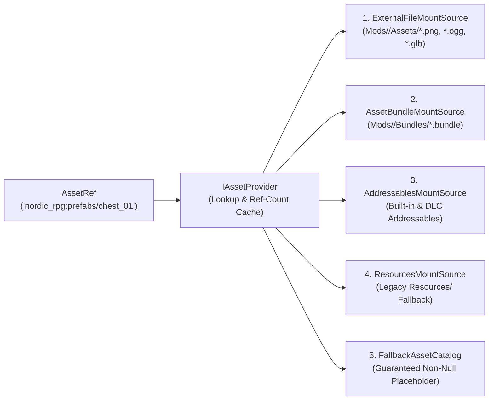

# FANTASY ENGINE — CONTENT & ASSET ARCHITECTURE SPECIFICATION
**Document ID**: `ARCH-03`  
**Layer**: Layer A (Engine Core Content & Asset Infrastructure) ↔ Layer B (Fantasy Framework Schemas)  
**Status Labels**: `EXISTING` | `TRANSITIONAL` | `PROPOSED` | `UNRESOLVED`

---

## 1. Executive Purpose: Data-Driven vs. Truly Moddable

> [!IMPORTANT]
> **Architectural Distinction**: A system using Unity `ScriptableObject`s or `enum`s is *data-driven* for a developer inside the Unity Editor, but it is **NOT moddable** in a standalone build if:
> 1. Content IDs are sequential integers (`ACT_0001`, `ITM_0002`) generated via `#if UNITY_EDITOR AssetDatabase.FindAssets` (verified in [`EntityData.cs`](file:///d:/Development/Game%20Development/3D%202D%20World/Assets/Data/Config/EntityData.cs#L15-L57)).
> 2. Systems rely on compile-time C# `enum`s (`enum SkyrimSkill`, `enum FactionType`, `enum QuestType` in `Assets/Scripts/Domain/Skyrim/`).
> 3. Lookup tables load strictly from `Resources.LoadAll` without external file mounting or override layers (verified in [`Database.cs`](file:///d:/Development/Game%20Development/3D%202D%20World/Assets/Data/Databases/Database.cs#L21-L24)).

This document specifies the **Content Architecture (`IContentService`, `ContentRegistry<T>`, `ResourceId`, `DefinitionRef<T>`)** and **Asset Architecture (`IAssetProvider`)** that unify built-in Unity assets and external user mods under one deterministic contract.

---

## 2. Verification of Existing Content & Registry Implementations

Our audit of the codebase identified **four separate, competing registry patterns** currently in use:

| Existing Class | File Path | Status | Verified Mechanism & Architectural Flaws |
|---|---|---|---|
| `EntityData` (`ActorData`, `ItemData`, `ContainerData`) | [`Assets/Data/Config/EntityData.cs`](file:///d:/Development/Game%20Development/3D%202D%20World/Assets/Data/Config/EntityData.cs) | `TRANSITIONAL` | Generates `ACT_0001` in `#if UNITY_EDITOR OnValidate()`. **Flaw**: Guaranteed ID collision between independent modders; does not work at runtime; does not implement `Core.IIdentifiable`. |
| `Database<T>` | [`Assets/Data/Databases/Database.cs`](file:///d:/Development/Game%20Development/3D%202D%20World/Assets/Data/Databases/Database.cs) | `TRANSITIONAL` | Uses `Resources.LoadAll<T>(ResourcesPath)` and O(N) `FirstOrDefault(d => d.Id == id)`. **Flaw**: Cannot load JSON or external mod files; `Initialize()` calls `ServiceLocator.Register(this)` which calls `Initialize()` again (infinite recursion risk). |
| `EntityRegistry` | [`Assets/Scripts/Domain/Entities/EntityRegistry.cs`](file:///d:/Development/Game%20Development/3D%202D%20World/Assets/Scripts/Domain/Entities/EntityRegistry.cs) | `TRANSITIONAL` | `ScriptableObject` with `List<EntityData>` and O(1) `Dictionary<string, EntityData>`. **Flaw**: Rejects duplicate IDs as errors rather than supporting mod override policies. |
| `BlockRegistry` | [`Assets/Scripts/Domain/Grid/BlockRegistry.cs`](file:///d:/Development/Game%20Development/3D%202D%20World/Assets/Scripts/Domain/Grid/BlockRegistry.cs) | `TRANSITIONAL` | Maps `ushort RuntimeId` -> `BlockDefinition`. **Flaw**: `RuntimeId` is manually serialized on the asset; mods will collide on `ushort` IDs unless the registry assigns compact runtime indices dynamically and stores a palette mapping per save file. |
| `CreatorCatalogSO` | [`Assets/Scripts/Domain/Creator/CreatorCatalogSO.cs`](file:///d:/Development/Game%20Development/3D%202D%20World/Assets/Scripts/Domain/Creator/CreatorCatalogSO.cs) | `TRANSITIONAL` | `ScriptableObject` with `List<CreatorItemDefinition>` and O(N) `items.Find(x => x.id == id)`. |

---

## 3. Namespaced Identifiers (`ResourceId`) & Strongly Typed References (`DefinitionRef<T>`)

### A. `ResourceId` (`PROPOSED` — Engine Core)
Every piece of content, asset, module, and event in the engine is addressed by an immutable, validated `ResourceId` formatted as `namespace:path`:
- **Format**: `<namespace>:<category>/<name>` or `<namespace>:<name>`
- **Validation Rules**: Lowercase ASCII letters (`a-z`), digits (`0-9`), underscores (`_`), and forward slashes (`/`) in the path segment.
- **Examples**:
  - `core:fallback_cube`
  - `nordic_rpg:skill/one_handed`
  - `nordic_rpg:faction/guards`
  - `nordic_rpg:item/iron_sword`
  - `frostfall_mod:spell/blizzard_cloak`
- **Legacy Alias Compatibility**: If legacy save/scene data passes `"ITM_0001"` or `"OneHanded"` without a colon, `ResourceId.ParseOrDefault(raw, defaultNamespace: "legacy")` normalizes it to `legacy:itm_0001` and checks the registry's alias table.

```csharp
namespace Core.Content
{
    using System;

    /// <summary>
    /// PROPOSED: Immutable, allocation-friendly namespaced identifier ('namespace:path').
    /// Replaces raw string IDs and fixed C# enums across all content registries.
    /// </summary>
    [Serializable]
    public readonly struct ResourceId : IEquatable<ResourceId>, IComparable<ResourceId>
    {
        public readonly string Namespace;
        public readonly string Path;
        public readonly int Hash; // Precomputed deterministic FNV-1a hash for fast dictionary lookup

        public bool IsValid => !string.IsNullOrEmpty(Namespace) && !string.IsNullOrEmpty(Path);
        public string FullId => IsValid ? $"{Namespace}:{Path}" : string.Empty;

        public ResourceId(string @namespace, string path)
        {
            Namespace = @namespace?.Trim().ToLowerInvariant() ?? string.Empty;
            Path      = path?.Trim().ToLowerInvariant() ?? string.Empty;
            Hash      = ComputeFnv1aHash(Namespace, Path);
        }

        public static ResourceId Parse(string rawId, string fallbackNamespace = "core") { /* Validates & splits on ':' */ throw new NotImplementedException(); }
        public static bool TryParse(string rawId, out ResourceId result) { throw new NotImplementedException(); }

        private static int ComputeFnv1aHash(string ns, string p) { /* Deterministic 32-bit FNV-1a */ return HashCode.Combine(ns, p); }

        public bool Equals(ResourceId other) => Hash == other.Hash && Namespace == other.Namespace && Path == other.Path;
        public override int GetHashCode() => Hash;
        public int CompareTo(ResourceId other) => string.CompareOrdinal(FullId, other.FullId);
        public override string ToString() => FullId;
    }
}
```

### B. Preventing Fragile String Architecture: `DefinitionRef<T>` (`PROPOSED`)
To prevent developers from passing an item ID into a method expecting a skill ID, all C# fields, component properties, and method signatures use `DefinitionRef<T>`:

```csharp
namespace Core.Content
{
    using System;
    using UnityEngine;

    /// <summary>
    /// PROPOSED: Strongly-typed reference to a content definition of type T.
    /// Serializes as a single 'namespace:path' string in JSON, and renders a searchable
    /// dropdown in the Unity Inspector (via Odin Drawer) and In-Game Editor.
    /// </summary>
    [Serializable]
    public struct DefinitionRef<T> : IEquatable<DefinitionRef<T>> where T : class, IContentDefinition
    {
        [SerializeField] private string _rawId;
        [NonSerialized] private ResourceId _parsedId;
        [NonSerialized] private T _cachedTarget;
        [NonSerialized] private int _cachedRegistryGeneration;

        public ResourceId Id => _parsedId.IsValid ? _parsedId : (_parsedId = ResourceId.Parse(_rawId));
        public bool IsEmpty => string.IsNullOrWhiteSpace(_rawId);

        public DefinitionRef(ResourceId id)
        {
            _rawId = id.FullId;
            _parsedId = id;
            _cachedTarget = null;
            _cachedRegistryGeneration = -1;
        }

        /// <summary>
        /// Resolves the definition in O(1) time (cached after first lookup until registry reloads).
        /// </summary>
        public T Resolve(IContentService contentService)
        {
            var registry = contentService.GetRegistry<T>();
            if (_cachedTarget != null && _cachedRegistryGeneration == registry.Generation)
                return _cachedTarget;

            _cachedTarget = registry.GetOrFallback(Id);
            _cachedRegistryGeneration = registry.Generation;
            return _cachedTarget;
        }

        public bool Equals(DefinitionRef<T> other) => Id.Equals(other.Id);
    }
}
```

---

## 4. Unified `IContentDefinition` & `ContentRegistry<T>`

### A. `IContentDefinition` Contract (`PROPOSED`)
All content models—whether loaded from a built-in Unity `ScriptableObject` wrapper or deserialized from an external JSON mod file—implement `IContentDefinition`:

```csharp
namespace Core.Content
{
    /// <summary>
    /// PROPOSED: Base contract for all data-driven definitions in the engine.
    /// Supersedes Core.IIdentifiable and Data.Config.EntityData ad-hoc IDs.
    /// </summary>
    public interface IContentDefinition
    {
        ResourceId Id { get; }
        string DisplayName { get; }
        string SourceModId { get; set; }
        int SchemaVersion { get; }

        /// <summary>
        /// Validates field ranges and verifies that all nested DefinitionRef&lt;T&gt; and AssetRef
        /// links exist in the active IContentService / IAssetProvider.
        /// </summary>
        void Validate(IValidationContext context);
    }
}
```

### B. Generic `ContentRegistry<T>` (`PROPOSED`)
Replaces `Database<T>`, `EntityRegistry`, `BlockRegistry`, and `CreatorCatalogSO` with a single unified implementation:

```csharp
namespace Core.Content
{
    using System.Collections.Generic;

    public enum RegistrationPolicy
    {
        AddOnly,          // Fails if ID already exists
        OverrideExisting, // Replaces existing entry and records override history (Last-Mod-Wins)
        MergePatch        // Applies partial JSON field patches onto existing entry
    }

    public sealed class ContentRegistry<T> where T : class, IContentDefinition
    {
        private readonly Dictionary<ResourceId, T> _entries = new();
        private readonly Dictionary<string, ResourceId> _legacyAliases = new();
        private readonly Dictionary<ResourceId, List<string>> _overrideProvenance = new();
        private T _fallbackDefinition;

        /// <summary>Incremented whenever mods are loaded/unloaded to invalidate DefinitionRef caches.</summary>
        public int Generation { get; private set; } = 1;

        public void SetFallback(T fallback) => _fallbackDefinition = fallback;

        public void Register(T definition, RegistrationPolicy policy = RegistrationPolicy.OverrideExisting);
        public bool TryGet(ResourceId id, out T definition);
        public T GetOrFallback(ResourceId id);
        public IReadOnlyCollection<T> GetAll();
        public void ValidateAll(IValidationContext context);
        public void ClearModEntries(string modId);
    }
}
```

**Solving `BlockRegistry`'s `ushort` Voxel ID Problem**:
In [`BlockRegistry.cs`](file:///d:/Development/Game%20Development/3D%202D%20World/Assets/Scripts/Domain/Grid/BlockRegistry.cs), voxel chunks store `ushort[] VoxelData` for memory density. In the new architecture, `BlockDefinition` is registered in `ContentRegistry<BlockDefinition>` by `ResourceId` (e.g., `core:cobblestone`). At runtime, `VoxelPaletteMap` dynamically assigns compact `ushort` indices (`1..N`) to active `ResourceId`s and serializes the `[ushort -> ResourceId]` LUT header inside `RoomSaveData`! Thus, two voxel mods never collide on `ushort` numbers.

---

## 5. Definition Composition vs. Inheritance

Instead of deep, rigid C# inheritance trees (`EntityData -> ItemData -> WeaponData -> MagicSwordData`), `EntityDefinition` and `ItemDefinition` use **shallow base metadata + composable `IDefinitionFragment` components** (inspired by `Ultimate Inventory System` and ECS archetypes):

- **Core Fields on every `ItemDefinition`**: `id`, `displayName`, `description`, `icon` (`AssetRef`), `worldPrefab` (`AssetRef`), `weight`, `baseValue`, `maxStackSize`, `tags` (`string[]`).
- **Composable Fragments (`fragments`)**:
  - `EquippableFragment`: `slot` (`main_hand`, `head`, `chest`), `armorRating`, `skillTag` (`nordic_rpg:skill/heavy_armor`).
  - `WeaponFragment`: `baseDamage`, `damageType` (`DefinitionRef<DamageTypeDefinition>`), `attackSpeed`, `staminaCost`, `range`, `governingSkill` (`DefinitionRef<SkillDefinition>`).
  - `ConsumableFragment`: `effects` (`RestoreAttribute`, `ApplyStatusEffect`).
  - `LockpickFragment`: `breakChanceMultiplier`, `skillBonus`.

This allows a modder to make a **Shield that is also a Consumable or a Weapon** simply by attaching fragments in JSON, without writing a new C# subclass!

---

## 6. Concrete JSON Examples: Modding Without Recompiling C#

Below are concrete examples of how the current Skyrim-style systems are expressed as pure JSON definitions in `Assets/Data/ContentPacks/NordicRPG/` or a user mod folder:

### Example 1: Custom Skill Definition (`skills/necromancy.json`)
Replaces `enum SkyrimSkill` in [`SkillData.cs`](file:///d:/Development/Game%20Development/3D%202D%20World/Assets/Scripts/Domain/Skyrim/SkillData.cs):
```json
{
  "$schema": "https://fantasyengine.local/schemas/skill.v1.json",
  "schemaVersion": 1,
  "id": "dark_arts_mod:skill/necromancy",
  "displayName": "Necromancy",
  "category": "magic",
  "description": "The forbidden art of raising Draugr and draining life essence.",
  "icon": "dark_arts_mod:icons/skill_necromancy",
  "startingLevel": 15,
  "maxLevel": 100,
  "xpCurve": {
    "formula": "linear_scale",
    "baseXp": 50.0,
    "levelMultiplier": 12.0
  },
  "xpTriggers": [
    {
      "eventType": "EntityDamagedEvent",
      "requiredDamageType": "dark_arts_mod:damage/necrotic",
      "xpPerUnit": 6.0
    }
  ]
}
```

### Example 2: Custom Item Definition (`items/ebony_scimitar.json`)
```json
{
  "$schema": "https://fantasyengine.local/schemas/item.v1.json",
  "schemaVersion": 1,
  "id": "hammerfell_mod:item/ebony_scimitar",
  "displayName": "Ebony Scimitar",
  "description": "A curved blade forged from volcanic glass and quenched in nightshade.",
  "icon": "hammerfell_mod:icons/ebony_scimitar",
  "worldPrefab": "nordic_rpg:prefabs/weapons/sword_curved_01",
  "weight": 11.5,
  "baseValue": 850,
  "maxStackSize": 1,
  "tags": ["weapon", "melee", "one_handed", "ebony"],
  "fragments": {
    "weapon": {
      "baseDamage": 28,
      "damageType": "nordic_rpg:damage/physical_slash",
      "attackSpeed": 1.15,
      "staminaCost": 14.0,
      "governingSkill": "nordic_rpg:skill/one_handed"
    }
  }
}
```

### Example 3: Custom Faction Definition (`factions/silver_hand.json`)
Replaces `enum FactionType` in [`FactionData.cs`](file:///d:/Development/Game%20Development/3D%202D%20World/Assets/Scripts/Domain/Skyrim/FactionData.cs):
```json
{
  "$schema": "https://fantasyengine.local/schemas/faction.v1.json",
  "schemaVersion": 1,
  "id": "companions_mod:faction/silver_hand",
  "displayName": "The Silver Hand",
  "defaultDisposition": "Neutral",
  "relationships": [
    { "targetFaction": "nordic_rpg:faction/player",  "disposition": "Hostile" },
    { "targetFaction": "nordic_rpg:faction/bandits", "disposition": "Hostile" },
    { "targetFaction": "nordic_rpg:faction/guards",  "disposition": "Neutral" }
  ]
}
```

### Example 4: Custom Creature / Actor Definition (`actors/frost_draugr_overlord.json`)
```json
{
  "$schema": "https://fantasyengine.local/schemas/actor.v1.json",
  "schemaVersion": 1,
  "id": "nordic_rpg:actor/frost_draugr_overlord",
  "displayName": "Frost Draugr Overlord",
  "prefab": "nordic_rpg:prefabs/characters/chr_headsman_01",
  "faction": "nordic_rpg:faction/draugr",
  "startingLevel": 20,
  "lifecyclePolicy": "PersistAndSleep",
  "attributes": [
    { "id": "core:attr/health",  "maxValue": 450, "regenRate": 0.5, "combatRegenMultiplier": 0.0 },
    { "id": "core:attr/stamina", "maxValue": 250, "regenRate": 10.0, "combatRegenMultiplier": 0.3 },
    { "id": "core:attr/magicka", "maxValue": 180, "regenRate": 5.0, "combatRegenMultiplier": 0.5 }
  ],
  "equippedItems": [
    "hammerfell_mod:item/ebony_scimitar"
  ],
  "lootTable": "nordic_rpg:loot/draugr_boss_chest"
}
```

### Example 5: Custom Quest Template Definition (`quests/hunt_silver_hand.json`)
Replaces `enum QuestType` and hardcoded switches in [`RadiantQuestService.cs`](file:///d:/Development/Game%20Development/3D%202D%20World/Assets/Scripts/Systems/Skyrim/RadiantQuestService.cs):
```json
{
  "$schema": "https://fantasyengine.local/schemas/quest_template.v1.json",
  "schemaVersion": 1,
  "id": "companions_mod:quest/purge_silver_hand_camp",
  "titleTemplate": "Vengeance: Purge {location}",
  "category": "bounty",
  "icon": "nordic_rpg:icons/quest_skull",
  "objectives": [
    {
      "objectiveId": "kill_leaders",
      "descriptionTemplate": "Eliminate Silver Hand Hunters in {location}",
      "targetEvent": "EntityKilledEvent",
      "targetFactionFilter": "companions_mod:faction/silver_hand",
      "requiredCount": 5
    }
  ],
  "rewards": {
    "baseGold": 250,
    "goldPerPlayerLevel": 15,
    "skillXpRewards": [
      { "skill": "nordic_rpg:skill/one_handed", "amount": 150.0 }
    ]
  }
}
```

---

## 7. Asset Architecture (`IAssetProvider` & Multi-Mount Resolution)

Content definitions never serialize raw Unity `Object` pointers in external files; they serialize `AssetRef` (`ResourceId` + expected asset type) which `IAssetProvider` resolves across four tiered storage backends.



### Comparison of Unity Asset Loading Mechanisms

| Mechanism | Strengths | Weaknesses | Recommended Role in Fantasy Engine |
|---|---|---|---|
| **Unity Addressables** | Async loading, automatic dependency tracking, memory ref-counting, ideal for large built-in packs (`POLYGON Fantasy Kingdom`). | Requires Unity Editor to build catalogs; awkward for casual text/image modders. | **Primary Built-In Content & Official DLC Backend**. |
| **Unity AssetBundles** | Can package custom Unity prefabs, shaders, animations, and particle systems (`Magic Arsenal`). | Platform/URP-version sensitive; requires modders to use our Unity Mod SDK Exporter. | **Advanced Asset Mod Backend** (for custom 3D prefabs/VFX). |
| **Raw External Files (`.png`, `.ogg`, `.wav`, `.glb`)** | Zero Unity Editor required! Modders drop a `.png` icon, `.ogg` sound, or Blender `.glb` mesh directly into their mod folder. | Cannot contain native Unity MonoBehaviours or ShaderGraphs directly (meshes bind to engine's standard URP Lit/Polygon shader). | **Zero-Friction Community Mod Backend** (`UnityWebRequestTexture` / `UnityWebRequestMultimedia` / GLTFast). |
| **`Resources.Load`** | Synchronous, zero setup, already used in existing scripts. | Bloats build startup memory; cannot be patched externally on disk. | **Transitional Fallback & Core Engine UI Defaults Only**. |

### `IAssetProvider` Contract (`PROPOSED`)

```csharp
namespace Core.Assets
{
    using System.Threading;
    using System.Threading.Tasks;
    using Core.Content;
    using UnityEngine;

    public interface IAssetProvider : IGameService
    {
        /// <summary>Asynchronously loads an asset from the highest-priority mounted source.</summary>
        Task<T> LoadAssetAsync<T>(ResourceId assetId, CancellationToken token = default) where T : UnityEngine.Object;

        /// <summary>Synchronous fast-path for prewarmed or cached assets; returns FallbackAsset if missing.</summary>
        T GetLoadedOrFallback<T>(ResourceId assetId) where T : UnityEngine.Object;

        /// <summary>Decrements reference count; unloads asset when count reaches 0.</summary>
        void ReleaseAsset(ResourceId assetId);

        /// <summary>Preloads all assets referenced by active registries during the Loading state.</summary>
        Task PrewarmActiveContentAssetsAsync(IProgress<float> progress = null, CancellationToken token = default);
    }
}
```

### Guaranteed Missing-Asset Fallbacks (`FallbackAssetCatalog`)
If a modder typos `"icon": "my_mod:icons/missing_sword"`, `IAssetProvider` logs a `MissingAssetWarning` to `IDiagnosticService` (with the exact source definition ID and file line) and returns a built-in **"Missing Icon (?)" Sprite** or **"Missing Mesh" Wireframe Cube** from `FallbackAssetCatalog`. **The game never throws a `NullReferenceException` due to a missing asset.**
