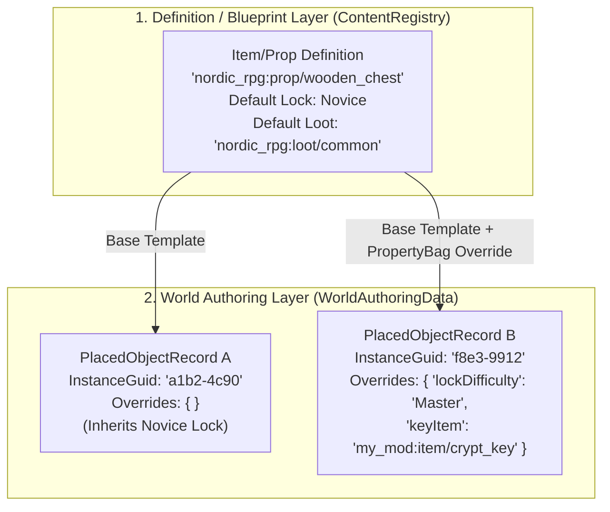
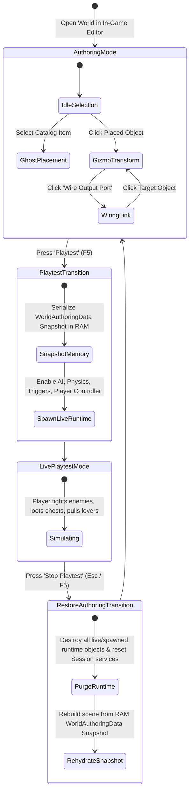
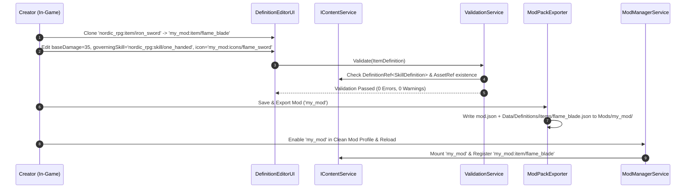
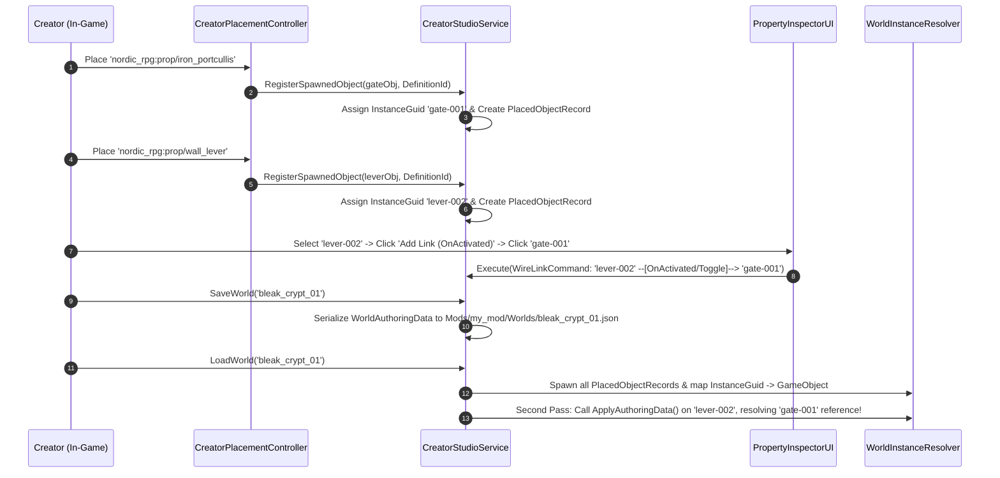

# FANTASY ENGINE — IN-GAME EDITOR ARCHITECTURE SPECIFICATION
**Document ID**: `ARCH-05`  
**Layer**: Layer A (Engine Core Authoring Suite) ↔ Layer B & C (Framework & Content Authoring)  
**Status Labels**: `EXISTING` | `TRANSITIONAL` | `PROPOSED` | `UNRESOLVED`

---

## 1. Executive Purpose

The Fantasy Engine includes an **Integrated In-Game Editor** that runs in standalone builds as well as the Unity Editor. Rather than merely spawning static prefabs, the In-Game Editor enables creators and modders to:
1. Build 3D modular dungeons, towns, and regions (`WorldAuthoringData`).
2. Inspect and customize individual placed instances (`PlacedObjectRecord` + `PropertyBag`).
3. Wire interactive logic between placed objects via persistent `InstanceGuid`s (e.g., linking a lever or pressure plate to a portcullis gate or enemy ambush spawner).
4. Create, clone, and edit content definitions (Items, Skills, Factions, Actors, Quests, Loot Tables).
5. Playtest levels immediately in-place with strict state isolation, and export creations as standard **Mod Packages (`mod.json` + `Data/` + `Worlds/`)**.

---

## 2. Verification of Existing In-Game Editor Implementations

| Existing Component | File Path | Status | Verified Capabilities & Current Architectural Gaps |
|---|---|---|---|
| `CreatorStudioService` | [`Assets/Scripts/Systems/Creator/CreatorStudioService.cs`](file:///d:/Development/Game%20Development/3D%202D%20World/Assets/Scripts/Systems/Creator/CreatorStudioService.cs) | `TRANSITIONAL` | Tracks `_isBuildMode`, `_activeItem`, `_spawnedObjects`, and serializes `CreatorLevelData` to `Assets/Data/SavedWorlds/*.json`. **Gaps**: Uses `Application.dataPath` (read-only in some standalone builds), uses `JsonUtility`, and stores no per-instance component properties or persistent GUIDs. |
| `CreatorPlacementController` | [`Assets/Scripts/Gameplay/Creator/CreatorPlacementController.cs`](file:///d:/Development/Game%20Development/3D%202D%20World/Assets/Scripts/Gameplay/Creator/CreatorPlacementController.cs) | `TRANSITIONAL` | Ghost preview mesh (`[GHOST]`), raycast grid snapping (`SnapToGrid`), rotation (`Q`/`E`/`R`), and demolition (`Delete`/`X`). **Gap**: Line 324 names instances using `spawned.GetInstanceID()`, which is a volatile Unity memory ID that changes on reload. |
| `CreatorSaveData` (`PlacedObjectRecord`) | [`Assets/Scripts/Domain/Creator/CreatorSaveData.cs`](file:///d:/Development/Game%20Development/3D%202D%20World/Assets/Scripts/Domain/Creator/CreatorSaveData.cs) | `TRANSITIONAL` | Serializes `itemId`, `posX/Y/Z`, `rotX/Y/Z/W`, `scaleX/Y/Z`. **Gap**: Cannot store chest lock difficulty, NPC faction overrides, or lever->door target links. |
| `LabService` & `LabHUD` | [`Assets/Scripts/Systems/Lab/LabService.cs`](file:///d:/Development/Game%20Development/3D%202D%20World/Assets/Scripts/Systems/Lab/LabService.cs) | `EXISTING` | Live runtime parameter sliders (`LabParameterGroup`). Ready to integrate as the **Live Tuning Tab** of the In-Game Editor. |
| `CuratorService` & `CuratorHUD` | [`Assets/Scripts/Systems/Museum/CuratorService.cs`](file:///d:/Development/Game%20Development/3D%202D%20World/Assets/Scripts/Systems/Museum/CuratorService.cs) | `EXISTING` | In-game exhibit rating and JSON report export (`MuseumEvaluationReport.json`). |

---

## 3. Core Architectural Principle: Blueprint Editing vs. Instance Editing

A frequent source of bugs in in-game editors is conflating **modifying a shared definition (Blueprint)** with **modifying a single placed object in a scene (Instance)**. The architecture enforces a strict separation:



1. **Editing a Definition (Definition Editor Mode)**:
   - Mutates or clones an `IContentDefinition` (e.g., `ActorDefinition`, `ItemDefinition`, `SkillDefinition`, `QuestTemplateDefinition`) inside the active working Mod workspace (`Mods/<WorkingModId>/Data/Definitions/`).
   - Changes affect **every** instance referencing that `ResourceId` that has not overridden the modified property.
2. **Editing a Placed Instance (World Inspector Mode)**:
   - Mutates the `PropertyBag` and `CrossObjectLink[]` on a specific `PlacedObjectRecord` identified by its `InstanceGuid` inside `WorldAuthoringData`.
   - Only that specific chest, lever, or NPC in that specific dungeon/world is affected.

---

## 4. Shared World Authoring Data Model (`TRANSITIONAL` → `PROPOSED`)

Both `CreatorStudioService` (In-Game Editor) and the Runtime World Loader consume `WorldAuthoringData` (evolving `CreatorLevelData` in [`CreatorSaveData.cs`](file:///d:/Development/Game%20Development/3D%202D%20World/Assets/Scripts/Domain/Creator/CreatorSaveData.cs)):

```csharp
namespace Domain.Creator
{
    using System;
    using System.Collections.Generic;
    using Core.Content;
    using UnityEngine;

    /// <summary>
    /// PROPOSED: Persistent 128-bit identifier for a placed object or runtime entity instance.
    /// Never changes across save/load cycles or editor sessions.
    /// </summary>
    [Serializable]
    public readonly struct InstanceGuid : IEquatable<InstanceGuid>
    {
        public readonly string Value; // 32-char lowercase hex or standard UUID string
        public bool IsValid => !string.IsNullOrEmpty(Value);
        public static InstanceGuid NewGuid() => new InstanceGuid(Guid.NewGuid().ToString("N"));
        public InstanceGuid(string value) { Value = value; }
        public bool Equals(InstanceGuid other) => string.Equals(Value, other.Value, StringComparison.Ordinal);
        public override int GetHashCode() => Value != null ? Value.GetHashCode() : 0;
        public override string ToString() => Value ?? string.Empty;
    }

    /// <summary>
    /// PROPOSED: Directed reference from one placed object to another in the world.
    /// Example: Lever ('sourceGuid') --[OnActivate]--> PortcullisGate ('targetGuid', 'ToggleOpen').
    /// </summary>
    [Serializable]
    public sealed class CrossObjectLink
    {
        public string OutputPortName;      // e.g., "OnActivated", "OnUnlocked", "OnSteppedOn"
        public InstanceGuid TargetGuid;    // Target object's persistent GUID
        public string TargetActionName;    // e.g., "Open", "Close", "Toggle", "SpawnWave"
        public float DelaySeconds = 0f;
    }

    /// <summary>
    /// TRANSITIONAL -> PROPOSED: Upgraded PlacedObjectRecord supporting persistent GUIDs,
    /// component property overrides, and cross-object wiring.
    /// </summary>
    [Serializable]
    public sealed class PlacedObjectRecord
    {
        public InstanceGuid InstanceId;
        public ResourceId DefinitionId;    // e.g., 'nordic_rpg:prop/iron_portcullis'
        public string CustomLabel;         // Optional designer label in hierarchy (e.g., 'Boss Room Gate')
        public Vector3 Position;
        public Quaternion Rotation;
        public Vector3 Scale = Vector3.one;

        /// <summary>Key-value component property overrides (e.g., 'lockDifficulty': 'Master').</summary>
        public Dictionary<string, string> PropertyOverrides = new();

        /// <summary>Wired references to other PlacedObjectRecords by InstanceGuid.</summary>
        public List<CrossObjectLink> Links = new();
    }

    /// <summary>
    /// TRANSITIONAL -> PROPOSED: Complete serializable world/dungeon document shared by Editor and Runtime.
    /// </summary>
    [Serializable]
    public sealed class WorldAuthoringData
    {
        public int SchemaVersion = 2;
        public ResourceId WorldId;
        public string DisplayName = "Custom Dungeon";
        public string Author = "Creator";
        public string CreatedAtUtc;
        public string ModifiedAtUtc;
        public List<string> RequiredModIds = new();
        public List<PlacedObjectRecord> PlacedObjects = new();
    }
}
```

### How Placed Objects Expose Editable Properties & Wiring Ports (`IAuthorableComponent`)
Any gameplay MonoBehaviour (`ChestInteractable`, `LeverInteractable`, `PressurePlateInteractable`, `BountyBoardInteractable`, `FactionComponent`) implements `IAuthorableComponent`:

```csharp
namespace Core.Editor
{
    using System.Collections.Generic;
    using Domain.Creator;

    public interface IAuthorableComponent
    {
        /// <summary>Declares inspector fields (int, float, string, bool, DefinitionRef, InstanceGuid) for the In-Game Property Inspector.</summary>
        IReadOnlyList<AuthorablePropertyDescriptor> GetPropertyDescriptors();

        /// <summary>Applies overrides from PlacedObjectRecord.PropertyOverrides and Links upon spawn.</summary>
        void ApplyAuthoringData(IReadOnlyDictionary<string, string> overrides, IReadOnlyList<CrossObjectLink> links, IWorldInstanceResolver resolver);

        /// <summary>Extracts current modified values back into PlacedObjectRecord when saving in Build Mode.</summary>
        void CaptureAuthoringData(IDictionary<string, string> overrides, IList<CrossObjectLink> links);
    }
}
```

---

## 5. Spatial Manipulation, Snapping & Undo/Redo Architecture

### A. Upgraded Snapping & Transform Modes (`CreatorPlacementController`)
Drawing from the architectural patterns in `GSpawn - Level Designer` and `HypertonicGames Grid Placement`:
1. **Grid & Modular Socket Snapping**:
   - Standard uniform grid snapping (`0.25m`, `0.5m`, `1.0m`, `2.0m`, `4.0m` matching Synty `POLYGON Fantasy Kingdom` modular wall/floor dimensions).
   - **Socket-to-Socket Snapping**: Modular walls, stairs, and doorways can include child `ModularSocket` markers (`WallEdge`, `DoorFrame`, `FloorEdge`) for automatic magnetic alignment.
2. **Surface Normal Alignment**:
   - Toggleable option for nature props (rocks, bushes, decals) to align their up-vector with terrain/surface normals while keeping architectural pieces strictly vertical (`Vector3.up`).
3. **3D Transform Gizmos**:
   - Selecting an already-placed object in `BuildMode` attaches a 3D Translate / Rotate / Scale gizmo and populates the UI Toolkit **Property Inspector Panel** with its `IAuthorableComponent` fields and a **"Wire Link..."**eyedropper tool.

### B. Deterministic Undo / Redo Command Stack (`ICommandHistory`)
Every mutation in the In-Game Editor is encapsulated as a reversible `IEditorCommand` serialized through data diffs (never holding raw destroyed `GameObject` references, which become invalid after `Destroy()`):

```csharp
namespace Core.Editor
{
    public interface IEditorCommand
    {
        string Description { get; }
        void Execute(IEditorWorkspaceContext context);
        void Undo(IEditorWorkspaceContext context);
    }
}
```
- **Standard Commands**:
  - `PlaceObjectCommand(PlacedObjectRecord record)` -> `Execute` spawns and registers `InstanceGuid`; `Undo` despawns by `InstanceGuid`.
  - `DeleteObjectCommand(PlacedObjectRecord snapshot)` -> `Execute` captures snapshot and despawns; `Undo` respawns from `snapshot` with the **exact same `InstanceGuid`** so existing links to it remain unbroken!
  - `TransformObjectCommand(InstanceGuid id, TransformData before, TransformData after)`
  - `ModifyPropertyCommand(InstanceGuid id, string key, string oldVal, string newVal)`
  - `WireLinkCommand(InstanceGuid sourceId, CrossObjectLink link)`

---

## 6. Build Mode vs. Playtest Mode State Isolation

A critical requirement of an in-game editor is that **playtesting a level (opening chests, killing enemies, triggering one-shot traps) must NEVER overwrite the authored level state**.



### Rules of State Isolation (`EditorPlaytestCoordinator`)
1. **In `AuthoringMode` (`BuildMode == true`)**:
   - `AreaSchedulerService`, `StealthDetectionService`, and NPC AI behavior trees are paused.
   - `LeverInteractable` and `ChestInteractable` do not run gameplay lockpicking or trap triggers when clicked—clicking them selects them in the Editor Inspector.
2. **Entering `LivePlaytestMode`**:
   - `EditorPlaytestCoordinator` serializes the current `WorldAuthoringData` into an immutable in-memory snapshot (`_authoringSnapshotJson`).
   - Editor gizmos and palettes hide; the player character spawns at the placed `PlayerSpawnPoint` marker; AI and triggers activate.
3. **Exiting `LivePlaytestMode`**:
   - All runtime-spawned projectiles, loot drops, dead corpses, and modified chest states are destroyed.
   - `CreatorStudioService` reconstructs the exact pre-playtest scene from `_authoringSnapshotJson`, preserving the user's `ICommandHistory` undo stack!

---

## 7. Complete Editor Workflows (Workflows C, D, and E)

### Workflow C: Creating Content & Exporting a Mod


### Workflow D: Editing the World & Wiring Persistent GUIDs

