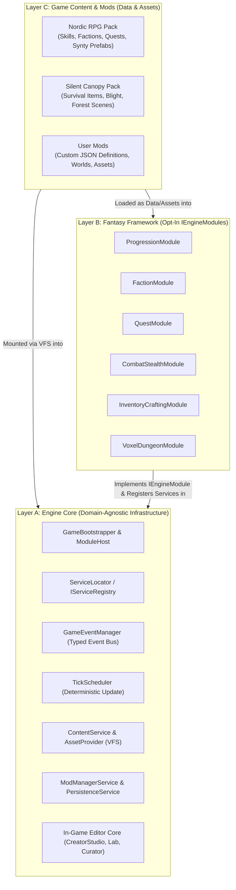

# FANTASY ENGINE — ENGINE CORE ARCHITECTURE SPECIFICATION
**Document ID**: `ARCH-01`  
**Layer**: Layer A — Engine Core  
**Status Labels**: `EXISTING` | `TRANSITIONAL` | `PROPOSED` | `UNRESOLVED`

---

## 1. Executive Purpose & Layer Boundaries

**Engine Core** is the domain-agnostic runtime foundation of the Fantasy Engine. It manages application startup, module composition, service resolution, deterministic frame ticking, typed event dispatch, object pooling, spatial simulation scheduling, virtual file mounting, and diagnostic logging.

### The Core Boundary Rule
> **Engine Core MUST compile, initialize, and run with zero references to Fantasy Framework concepts** (skills, attributes, mana, swords, factions, quests, or voxel blocks) and **zero references to Game Content** (Skyrim, Draugr, Whiterun, or Jack & Lucian).



---

## 2. Verification of Existing Engine Core Implementation

Before specifying changes, every existing Core and foundational System class was audited against the actual C# source code:

| Component | Source File | Status | Current Implementation & Verified Limitations |
|---|---|---|---|
| `GameBootstrapper` | [`Assets/Scripts/Core/GameBootstrapper.cs`](file:///d:/Development/Game%20Development/3D%202D%20World/Assets/Scripts/Core/GameBootstrapper.cs) | `TRANSITIONAL` | Singleton `MonoBehaviour` (`[DefaultExecutionOrder(-100)]`). **Strength**: Centralizes initialization and `ITickable` loop. **Defect**: `InitializeServices()` (lines 53–114) hardcodes 17 concrete services including `Systems.Skyrim.*` and instantiates 8 concrete HUD prefabs via `Resources.Load` / `#if UNITY_EDITOR AssetDatabase`. |
| `IGameService` | [`Assets/Scripts/Core/IGameService.cs`](file:///d:/Development/Game%20Development/3D%202D%20World/Assets/Scripts/Core/IGameService.cs) | `EXISTING` | Clean interface with `void Initialize()` and `void Shutdown()`. Called synchronously inside `ServiceLocator.Register<T>()`. |
| `ITickable` | [`Assets/Scripts/Core/ITickable.cs`](file:///d:/Development/Game%20Development/3D%202D%20World/Assets/Scripts/Core/ITickable.cs) | `EXISTING` | Single method `void Tick(float deltaTime)`. Driven by `GameBootstrapper.Update()`. Lacks phase ordering (Input vs. Simulation vs. UI) and exception isolation. |
| `ServiceLocator` | [`Assets/Scripts/Core/ServiceLocator.cs`](file:///d:/Development/Game%20Development/3D%202D%20World/Assets/Scripts/Core/ServiceLocator.cs) | `TRANSITIONAL` | Static dictionary `Dictionary<Type, IGameService>`. **Strength**: Simple, fast, supports `TryGet<T>`. **Defect**: Immediately invokes `service.Initialize()` inside `Register<T>()` before peer services exist, creating hidden registration-order bugs if Service A's `Initialize()` queries Service B. |
| `GameEventManager` | [`Assets/Scripts/Core/GameEventManager.cs`](file:///d:/Development/Game%20Development/3D%202D%20World/Assets/Scripts/Core/GameEventManager.cs) | `TRANSITIONAL` | Static `Dictionary<Type, List<Delegate>>`. **Strength**: Copies listener array (`listeners.ToArray()`) before invoking, making mid-dispatch unsubscribe safe. **Defect**: No `try/catch` around listener invocation—a single throwing mod listener aborts event delivery to all subsequent listeners. |
| `GameStateMachine` | [`Assets/Scripts/Domain/StateMachine/GameStateMachine.cs`](file:///d:/Development/Game%20Development/3D%202D%20World/Assets/Scripts/Domain/StateMachine/GameStateMachine.cs) | `TRANSITIONAL` | Async state machine (`TransitionToAsync(IGameState)`). **Defect**: Lives in `Domain.Entities.StateMachine` namespace and `Playing` state (in `GameStates.cs`) hardcodes `LevelCompletedEvent` -> `LevelGenerationRequestedEvent`. |
| `PoolingManager` | [`Assets/Scripts/Systems/Pooling/PoolingManager.cs`](file:///d:/Development/Game%20Development/3D%202D%20World/Assets/Scripts/Systems/Pooling/PoolingManager.cs) | `TRANSITIONAL` | Pools `MonoBehaviour` instances under `PoolContainer`. **Defect**: Keys pools by `$"{prefab.name}_{typeof(T).Name}"` (line 19)—if two mods have prefabs named `"Chest"`, their pools collide! |
| `AreaSchedulerService` | [`Assets/Scripts/Systems/Scheduler/AreaSchedulerService.cs`](file:///d:/Development/Game%20Development/3D%202D%20World/Assets/Scripts/Systems/Scheduler/AreaSchedulerService.cs) | `TRANSITIONAL` | Manages `Active`, `Dormant`, and `Purged` simulation tiers and off-screen health regeneration catch-up. Currently coupled to `LevelLayout` rooms; should support open-world spatial grid cells as well. |

---

## 3. Service Registration, Resolution & Dependency Strategy

### Evaluation: Evolve `ServiceLocator` vs. Full DI Container
- **Alternatives Considered**:
  1. *Third-Party DI Container (VContainer / Zenject)*: Powerful constructor injection, but introduces heavy reflection/IL-weaving overhead, steepens the learning curve for modders, and requires rewriting all 20+ existing services and MonoBehaviours.
  2. *Evolved Two-Phase `ServiceLocator` + `IServiceRegistry` (**RECOMMENDED**)*: Preserves 100% backward compatibility with `ServiceLocator.Get<T>()` and `ServiceLocator.TryGet<T>(out var svc)`, while separating **Registration (`Register`)** from **Initialization (`InitializeAll`)** and allowing interface-to-implementation binding (`Register<IFactionService, FactionService>(instance)`).

### Proposed Service Locator Evolution (`TRANSITIONAL` → `PROPOSED`)

```csharp
namespace Core
{
    using System;

    /// <summary>
    /// PROPOSED: Optional interface for services that require two-phase initialization
    /// after all module services have been registered in the ServiceLocator.
    /// </summary>
    public interface IPostInitializable
    {
        /// <summary>
        /// Called after all active modules have registered their services.
        /// Safe to call ServiceLocator.Get&lt;T&gt;() for cross-service dependencies here.
        /// </summary>
        void PostInitialize();
    }

    /// <summary>
    /// PROPOSED: Contract passed to IEngineModule.RegisterServices() to enforce
    /// controlled registration and track which module owns which service.
    /// </summary>
    public interface IServiceRegistry
    {
        void Register<TService>(TService instance) where TService : class, IGameService;
        void Register<TInterface, TImplementation>(TImplementation instance)
            where TInterface : class, IGameService
            where TImplementation : class, TInterface;
        bool IsRegistered<TService>() where TService : class, IGameService;
    }
}
```

### Service Lifetimes
All services registered in `ServiceLocator` have one of two explicit lifetimes:
1. **Engine Lifetime (`EngineGlobal`)**: Created during `GameBootstrapper` startup; persists across scene loads and mod profile reloads (`InputManager`, `ModManagerService`, `ContentService`, `AssetProvider`, `AudioService`).
2. **Session / Profile Lifetime (`SessionScoped`)**: Recreated or reset when a Mod Profile changes, a new game starts, or a save is loaded (`SkillProgressionService`, `FactionService`, `RadiantQuestService`, `AreaSchedulerService`, `PoolingManager`).

---

## 4. Deterministic Tick & Update Scheduling

### The Problem with Unordered `List<ITickable>`
Currently, `GameBootstrapper` iterates `_tickables` in registration order. If a mod registers a tickable before `InputManager`, or if UI updates before combat damage is resolved, frame-lag and race conditions occur.

### Proposed Tick Scheduler (`PROPOSED`)
We preserve `ITickable` (`void Tick(float deltaTime)`) and introduce `TickGroup` ordering:

```csharp
namespace Core
{
    /// <summary>
    /// PROPOSED: Deterministic execution buckets within a single Unity Update frame.
    /// </summary>
    public enum TickGroup
    {
        Input        = 0,   // InputManager polling
        PreSimulation = 100, // AreaSchedulerService tier updates, timers
        Simulation   = 200, // StealthDetectionService, SkillProgressionService, AI
        World        = 300, // WorldMapService, environment/weather updates
        Presentation = 400, // CompassService, UI/HUD model updates
        Diagnostics  = 500  // Profiling, LabService live monitors
    }

    /// <summary>
    /// PROPOSED: Optional extension to ITickable allowing a service to declare its TickGroup
    /// and relative priority within that group. Defaults to TickGroup.Simulation (priority 0).
    /// </summary>
    public interface IOrderedTickable : ITickable
    {
        TickGroup Group { get; }
        int OrderInGroup { get; }
    }
}
```

**Failure Isolation in Tick Loop**:
`GameBootstrapper.Update()` wraps each `tickable.Tick(deltaTime)` in a `try/catch` block coupled with a circuit breaker: if a module's tickable throws 5 consecutive unhandled exceptions, `TickScheduler` disables that tickable, logs a structured `EngineDiagnosticError`, and keeps the rest of the engine running.

---

## 5. Hardened Typed Event Bus (`GameEventManager`)

### Enhancements Needed for Modding & Editor (`TRANSITIONAL` → `PROPOSED`)
1. **Exception Isolation**:
   - In [`GameEventManager.Publish<T>`](file:///d:/Development/Game%20Development/3D%202D%20World/Assets/Scripts/Core/GameEventManager.cs#L73-L81), wrap each `((Action<T>)listener)?.Invoke(gameEvent)` in a `try/catch (Exception ex)` so a broken subscriber in a mod never prevents core systems or UI from receiving the event.
2. **Subscription Scopes (`EventSubscriptionToken` / `EventScope`)**:
   - When a mod or game module is deactivated, all of its event listeners must be cleanly removed even if an author forgot a `RemoveListener` call.
3. **String/Keyed Dynamic Event Bridge (`DynamicGameEvent`)**:
   - While C# systems use compile-time `GameEventManager.Publish<T>(T evt)`, declarative mods and the In-Game Editor (`MakinomSchematicTrigger`, custom lever/trap actions) publish and listen to `DynamicTriggerEvent` carrying a `ResourceId EventId` and a `PropertyBag Payload`.

```csharp
namespace Core
{
    using System;

    /// <summary>
    /// PROPOSED: Priority levels for deterministic listener execution order.
    /// </summary>
    public enum EventPriority
    {
        Highest = -200, // Pre-validation / interception
        High    = -100, // Core state mutation
        Normal  = 0,    // Standard gameplay listeners (Default)
        Low     = 100,  // Secondary reactions (Quest objective counters)
        Monitor = 200   // UI toasts, audio cues, analytics, logging (Read-only)
    }
}
```

---

## 6. Eliminating Hardcoded Skyrim Dependencies from `GameBootstrapper`

### Current State (`EXISTING`)
In [`GameBootstrapper.InitializeServices()`](file:///d:/Development/Game%20Development/3D%202D%20World/Assets/Scripts/Core/GameBootstrapper.cs#L53-L114), lines 87–111 directly instantiate `CompassService`, `StealthDetectionService`, `SkillProgressionService`, `FactionService`, `RadiantQuestService`, and `RPGOverlayHUD`.

### Target Architecture (`PROPOSED`)
`GameBootstrapper` only initializes **Engine Core** services (`GameStateMachine`, `InputManager`, `PoolingManager`, `VirtualFileSystem`, `ContentService`, `AssetProvider`, `ModManagerService`, `FileSaveService`, `DiagnosticService`) and then delegates feature composition to `ModuleHost`:

```csharp
namespace Core.Modules
{
    using System.Collections.Generic;
    using UnityEngine;

    /// <summary>
    /// PROPOSED: ScriptableObject or JSON-backed boot configuration that defines
    /// which modules and default content packs are loaded for this game product.
    /// </summary>
    [CreateAssetMenu(fileName = "EngineBootstrapProfile", menuName = "FantasyEngine/Core/Bootstrap Profile")]
    public sealed class EngineBootstrapProfile : ScriptableObject
    {
        [Tooltip("Default profile ID (e.g., 'core:nordic_rpg_boot' or 'core:minimal_editor_boot')")]
        public string ProfileId = "core:default_boot";

        [Tooltip("Ordered list of built-in module class names or module ScriptableObject assets to activate.")]
        public List<string> BuiltInModuleIds = new()
        {
            "core:editor_studio",
            "framework:entities_and_stats",
            "framework:inventory_and_crafting",
            "framework:combat_and_stealth",
            "framework:progression_and_skills",
            "framework:factions_and_reputation",
            "framework:quests_and_navigation",
            "framework:voxel_dungeon_gen"
        };

        [Tooltip("Default content packs mounted after modules initialize.")]
        public List<string> BaseContentPackIds = new()
        {
            "content:nordic_fantasy_pack"
        };

        [Tooltip("Initial game state to enter after bootstrap completes.")]
        public string InitialGameState = "Playing";
    }
}
```

With `EngineBootstrapProfile`:
- Running the **Skyrim Proving Ground** loads all `framework:*` modules plus `content:nordic_fantasy_pack`.
- Running a **Pure Voxel Builder** loads only `core:editor_studio` and `framework:voxel_dungeon_gen`.
- Running **Engine Core Unit Tests** loads zero `framework:*` modules, proving Engine Core's complete independence.

---

## 7. Diagnostics & Structured Logging (`IDiagnosticService`)

Modders and level designers working in a standalone build do not have access to the Unity Editor Console. Engine Core provides an `IDiagnosticService`:
- **Structured Log Entries**: Captures `Severity` (`Info`, `Warning`, `Error`, `Fatal`), `SourceId` (e.g., `mod:nordic_overhaul` or `framework:factions`), `Category` (`Manifest`, `SchemaValidation`, `MissingAsset`, `RuntimeException`), `Message`, and `ContextPath`.
- **In-Game Diagnostic Overlay**: Viewable in the In-Game Editor and Mod Manager UI so modders immediately see why a JSON file failed validation or which `ResourceId` could not be resolved.

---

## 8. Summary of Core Subsystem Transition Plan

| Subsystem | What Exists | What Can Be Reused | What Changes Eventually | What Is Entirely New |
|---|---|---|---|---|
| **Bootstrapper** | `GameBootstrapper.cs` | Singleton lifecycle, `DontDestroyOnLoad`, `Update()` tick driver | Remove hardcoded Skyrim service & HUD instantiations | `EngineBootstrapProfile`, `ModuleHost` orchestration |
| **Service Locator** | `ServiceLocator.cs`, `IGameService.cs` | `Get<T>()`, `TryGet<T>()`, `Clear()` | Separate `Register` from `Initialize`; support interface keys | `IServiceRegistry`, `IPostInitializable` |
| **Event Bus** | `GameEventManager.cs`, `GameEvent.cs` | Generic `AddListener<T>`, `RemoveListener<T>`, `Publish<T>` | Wrap listener dispatch in `try/catch`; add `EventPriority` | `EventScope` (auto-unsubscribe per module/mod), `DynamicTriggerEvent` |
| **Tick Loop** | `ITickable.cs`, `_tickables` list | `ITickable` interface contract | Sort tickables by `TickGroup` & priority; add fault circuit breaker | `TickGroup` enum, `IOrderedTickable` |
| **Object Pooling** | `PoolingManager.cs`, `MonoBehaviourPool.cs` | Pool warming, container transform, release logic | Key pools by `Prefab.GetInstanceID()` or `ResourceId` instead of `prefab.name` | Pool auto-purge on Mod Profile unload |
