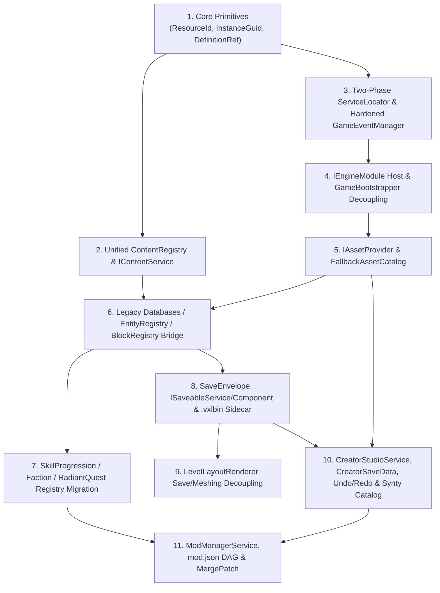

# FANTASY ENGINE — SYSTEM-BY-SYSTEM MIGRATION MATRIX
**Document ID**: `ARCH-10`  
**Role**: Principal Engine Architect & Migration Planner  
**Purpose**: Concrete 3-stage evolutionary mapping (`CURRENT IMPLEMENTATION → TRANSITIONAL IMPLEMENTATION → TARGET ARCHITECTURE`) for all 17 core, framework, editor, and persistence subsystems, including exact prerequisite ordering so the project compiles and runs at every step.

---

## 1. Migration Dependency Graph

No subsystem may skip its transitional bridge if downstream gameplay scripts or scenes (`RPGProvingGrounds.unity`) depend on its current public API. The diagram below defines the strict prerequisite order across subsystems:

---

## 2. Subsystem Migration Matrix (`CURRENT → TRANSITIONAL → TARGET`)

### 2.1 Engine Core & Bootstrapping (`Layer A`)

| # | Subsystem | CURRENT IMPLEMENTATION (`EXISTING`) | TRANSITIONAL IMPLEMENTATION (`BRIDGE`) | TARGET ARCHITECTURE (`PROPOSED`) | Prerequisites |
|---|---|---|---|---|---|
| **1** | **[`GameBootstrapper`](file:///d:/Development/Game%20Development/3D%202D%20World/Assets/Scripts/Core/Bootstrap/GameBootstrapper.cs)** | Directly instantiates and registers 17 concrete services (including `SkillProgressionService`, `FactionService`, `RadiantQuestService`, `CreatorStudioService`, `LabService`, `CuratorService`); holds serialized `_databases` and `_creatorCatalog`. | Delegates registration to `ModuleHost` configured with built-in wrapper modules (`CoreModule`, `FantasyFrameworkModule`, `EditorStudioModule`, `ShowcaseModule`). Retains `[SerializeField] private Databases _databases` and `_creatorCatalog` as `[Obsolete]` inspector fields that pass their references into the transitional modules so `RPGProvingGrounds.unity` requires zero scene edits. | Pure Layer A Engine Host driven by `EngineBootstrapProfile` asset. Zero `using Systems.Skyrim;` or `using Data.Databases;` imports in `GameBootstrapper.cs`. | `#2 ServiceLocator`, `#3 GameEventManager` |
| **2** | **[`ServiceLocator`](file:///d:/Development/Game%20Development/3D%202D%20World/Assets/Scripts/Core/Services/ServiceLocator.cs)** | Single-phase `Register<T>(T service)` that immediately invokes `service.Initialize()`, causing boot-order bugs when Service A looks up Service B before Service B is registered. | Adds `Register<TInterface, TImpl>(TImpl instance)` and two-phase mode (`BeginRegistrationPhase()` / `InitializeAllRegistered()`). Legacy `Register<T>(T)` checks `_isRegistrationPhase`: if true, queues `Initialize()` for Phase 2; if false (e.g., unit tests calling `Register` directly), calls `Initialize()` immediately for backward compatibility. | Strict Two-Phase `IServiceRegistry` + `IServiceProvider` where `Get<T>()` during Phase 1 throws a clear `EngineLifecycleException` and all services resolve cleanly in Phase 2 topological order. | None |
| **3** | **[`GameEventManager`](file:///d:/Development/Game%20Development/3D%202D%20World/Assets/Scripts/Core/Events/GameEventManager.cs)** | Uses `Dictionary<Type, Delegate>` with `Delegate.Combine` / `Delegate.Remove`. Unhandled exception in one listener aborts the entire `Publish<T>()` invocation chain. | Replaces internal `Delegate` dictionary with per-type `EventSubscriptionList<T>` supporting snapshot iteration and per-listener `try/catch` diagnostic logging while keeping `Subscribe<T>(Action<T>)`, `Unsubscribe<T>(Action<T>)`, and `Publish<T>(T)` signatures 100% identical. | Adds `SubscribeScoped<T>(Action<T>, IEventScope)` so modules and active mods automatically auto-unsubscribe all handlers upon module unload or profile switch. | None |

---

### 2.2 Content Definitions & Registries (`Layer A` / `Layer B`)

| # | Subsystem | CURRENT IMPLEMENTATION (`EXISTING`) | TRANSITIONAL IMPLEMENTATION (`BRIDGE`) | TARGET ARCHITECTURE (`PROPOSED`) | Prerequisites |
|---|---|---|---|---|---|
| **4** | **[`Database<T>`](file:///d:/Development/Game%20Development/3D%202D%20World/Assets/Data/Databases/Database.cs) & [`Databases`](file:///d:/Development/Game%20Development/3D%202D%20World/Assets/Data/Databases/Databases.cs)** | Four ScriptableObject wrappers (`ActorDatabase`, `ItemDatabase`, `ContainerDatabase`, `RegionDatabase`) that self-register in `ServiceLocator` and use `#if UNITY_EDITOR AssetDatabase` to populate. | Introduce `ContentRegistry<T>` and `IContentService`. At startup, a `LegacyDatabaseBridge` iterates all entries in `Databases` (`ActorDatabase`, `ItemDatabase`, `ContainerDatabase`) and registers them into `ContentRegistry<T>` with synthesized `ResourceId`s (e.g., `ACT_0001` -> `nordic_rpg:actor/act_0001`) plus a secondary alias index for `"ACT_0001"`. | `Database<T>` and `Databases` are retired after all `.asset` definitions are registered via `ContentPackManifest` / `IContentService`. | `#1 ResourceId & ContentRegistry<T>` |
| **5** | **[`EntityData`](file:///d:/Development/Game%20Development/3D%202D%20World/Assets/Data/Config/EntityData.cs) (`ActorData`, `ItemData`, `ContainerData`, `BlockDefinition`)** | Base `ScriptableObject` with `string _id` (`ACT_0001`) generated via `private void OnValidate()` using `AssetDatabase.FindAssets`. `BlockDefinition` shadows `private void OnValidate()`. | 1. Change `EntityData.OnValidate()` to `protected virtual void OnValidate()` and fix `BlockDefinition` to call `base.OnValidate()`. 2. Implement `IContentDefinition` (`ResourceId ContentId`) on `EntityData`. If `_resourceId` is empty, auto-derive `nordic_rpg:<type>/<normalized_id>` from `_id` or asset name. 3. Add explicit `[SerializeField] private DefinitionRef<BlockDefinition> _placeableBlock` to `ItemData`. | Dual-representation definitions: authorable either as Unity `ScriptableObject`s (for built-in packs) or external JSON files (`Items/*.json`, `Actors/*.json`) hydrated into runtime `IContentDefinition` records. | `#1 ResourceId & ContentRegistry<T>` |
| **6** | **[`EntityRegistry`](file:///d:/Development/Game%20Development/3D%202D%20World/Assets/Scripts/Domain/Registries/EntityRegistry.cs)** | Standalone `ScriptableObject` holding `List<EntityData>` with dictionary lookup by string `Id`; duplicates `Databases`. | `EntityRegistry.TryGetEntity(string id, out EntityData)` forwards lookups to `IContentService.GetRegistry<EntityData>()` (checking both `ResourceId` and legacy string alias) before falling back to its local list. Marked `[Obsolete]`. | Removed in favor of `IContentService.GetRegistry<EntityData>()`. | `#4 ContentRegistry<T>` |
| **7** | **[`BlockRegistry`](file:///d:/Development/Game%20Development/3D%202D%20World/Assets/Scripts/Domain/World/BlockRegistry.cs)** | `ScriptableObject` loaded via `Resources.Load<BlockRegistry>("DefaultBlockRegistry")`; maps `ushort BlockId -> BlockDefinition`. | Registers all `BlockDefinition`s into `ContentRegistry<BlockDefinition>` and builds a deterministic `VoxelPaletteMap` (`ResourceId <-> ushort`). `BlockRegistry.GetBlock(ushort)` remains functional for `GreedyMeshingService` and `HotbarService`. | `VoxelDungeonModule` manages `ContentRegistry<BlockDefinition>` and generates per-world `VoxelPaletteMap` so modders can add custom blocks (`my_mod:block/obsidian`) without `ushort` ID collisions! | `#4 ContentRegistry<T>`, `#5 EntityData` |
| **8** | **[`CreatorCatalogSO`](file:///d:/Development/Game%20Development/3D%202D%20World/Assets/Scripts/Domain/Creator/CreatorCatalogSO.cs)** | `ScriptableObject` holding `List<CreatorItemDefinition>` with string `Id` and direct `GameObject Prefab` reference; populated by `CreatorStudioSetup.cs` with 12 `Assets/Cowsins/` prefabs. | 1. Add `ResourceId ContentId` and `ResourceId PrefabAssetId` to `CreatorItemDefinition`. 2. Import `CreatorCatalogSO` entries into `ContentRegistry<CreatorItemDefinition>`. 3. Update `CreatorStudioSetup.cs` and `DefaultCreatorCatalog.asset` to use Synty `POLYGON Fantasy Kingdom` prefabs instead of `Assets/Cowsins/`. | `ContentRegistry<CreatorItemDefinition>` dynamically aggregates placeable prefabs from built-in Synty packs and any active mod (`Placeables/*.json` + `IAssetProvider`). | `#4 ContentRegistry<T>`, `#5 IAssetProvider` |

---

### 2.3 In-Game Editor & Persistence (`Layer A`)

| # | Subsystem | CURRENT IMPLEMENTATION (`EXISTING`) | TRANSITIONAL IMPLEMENTATION (`BRIDGE`) | TARGET ARCHITECTURE (`PROPOSED`) | Prerequisites |
|---|---|---|---|---|---|
| **9** | **[`CreatorStudioService`](file:///d:/Development/Game%20Development/3D%202D%20World/Assets/Scripts/Systems/Creator/CreatorStudioService.cs)** | Spawns prefabs from `CreatorCatalogSO` under `_levelRoot`; saves/loads `CreatorLevelData` via `JsonUtility`; enters Playtest simply by switching state to `GameplayState` without snapshotting scene mutations! | 1. Assigns a deterministic `InstanceGuid` (`EditorPlacedEntityTag`) to every spawned object. 2. Adds `ICommandHistory` (`Undo()` / `Redo()`). 3. Adds `EditorPlaytestCoordinator`: serializes in-memory `WorldAuthoringData` snapshot before entering Playtest and restores the exact authored state upon exiting Playtest. | Full In-Game Editor service supporting `WorldAuthoringData`, `CrossObjectLink` target wiring, `PropertyOverrides` inspector, and one-click Mod Folder Export (`mod.json` + `Worlds/*.json`). | `#8 CreatorCatalogSO`, `#10 CreatorSaveData` |
| **10** | **[`CreatorSaveData`](file:///d:/Development/Game%20Development/3D%202D%20World/Assets/Scripts/Systems/Creator/CreatorSaveData.cs)** | `CreatorLevelData` + `PlacedObjectRecord` (`ItemId`, `Position`, `Rotation`, `Scale`). Lacks `SchemaVersion`, `InstanceGuid`, `PropertyOverrides`, and `Links`. | Upgrades `PlacedObjectRecord` with `InstanceGuid InstanceId`, `ResourceId DefinitionId`, `Dictionary<string, JToken> PropertyOverrides`, and `List<CrossObjectLink> Links`. Includes a schema v1 -> v2 importer that reads legacy `ItemId` strings and auto-assigns `InstanceGuid`s to old saves. | Canonical `WorldAuthoringData` serialized via `Newtonsoft.Json` with optional `.vxlbin` binary sidecar for voxel chunks. | `#1 ResourceId & InstanceGuid` |
| **11** | **[`CreatorPlacementController`](file:///d:/Development/Game%20Development/3D%202D%20World/Assets/Scripts/Gameplay/Creator/CreatorPlacementController.cs)** | Raycasts placement, creates uncached ghost material on every item switch, deletes objects using volatile `GetInstanceID().ToString()`. | 1. Caches `_ghostPreviewMaterial` once in `Awake()`. 2. Reads `EditorPlacedEntityTag.InstanceId` (`InstanceGuid`) on right-click delete and routes Place, Move, Rotate, and Delete actions through `CreatorStudioService.CommandHistory.Execute(...)`. | Modular Editor Tool Controller supporting Place Tool, Select/Transform Gizmo Tool, Link Wiring Tool (connecting `LeverInteractable` to doors/traps), and Property Inspector. | `#9 CreatorStudioService`, `#10 CreatorSaveData` |
| **12** | **[`FileSaveService`](file:///d:/Development/Game%20Development/3D%202D%20World/Assets/Scripts/Systems/Save/FileSaveService.cs) & [`SaveData`](file:///d:/Development/Game%20Development/3D%202D%20World/Assets/Scripts/Systems/Save/SaveData.cs)** | Passive `JsonUtility` wrapper called only by `LevelLayoutRenderer`; stores `LevelSaveData` with inline `ushort[] VoxelData` and hardcoded fields. Saving does not work in `RPGProvingGrounds.unity`! | 1. `FileSaveService` subscribes directly to `GameSaveRequestedEvent` and `GameLoadRequestedEvent` so saving works in **all** scenes (`RPGProvingGrounds.unity` included!). 2. Introduces `SaveEnvelope` (JSON metadata + `ModuleStates` + `EntitySaveRecord`s) and `.vxlbin` binary sidecar (`ADR-009`). 3. Retains `ReadData()` / `WriteData(LevelSaveData)` marked `[Obsolete]` as a wrapper until `LevelLayoutRenderer` is migrated. | Modular Persistence Engine orchestrating `ISaveableService` modules, `ISaveableComponent` entities (`InstanceGuid` delta + tombstone tracking), mod dependency validation on load, and `.vxlbin` compressed voxel payloads. | `#1 ResourceId & InstanceGuid`, `#3 GameEventManager` |

---

### 2.4 Fantasy Framework & Voxel Systems (`Layer B`)

| # | Subsystem | CURRENT IMPLEMENTATION (`EXISTING`) | TRANSITIONAL IMPLEMENTATION (`BRIDGE`) | TARGET ARCHITECTURE (`PROPOSED`) | Prerequisites |
|---|---|---|---|---|---|
| **13** | **[`SkillProgressionService`](file:///d:/Development/Game%20Development/3D%202D%20World/Assets/Scripts/Systems/Skyrim/SkillProgressionService.cs) & [`SkillData`](file:///d:/Development/Game%20Development/3D%202D%20World/Assets/Scripts/Domain/Skyrim/SkillData.cs)** | Hardcodes 18 skills via `enum SkyrimSkill` in `InitializeDefaultSkills()`; keys dictionary by `SkyrimSkill`. Does not persist unlocked perks in `SaveData`. | 1. Introduces `SkillDefinition` (`ResourceId`) in `ContentRegistry<SkillDefinition>` populated with the 18 Nordic RPG skills. 2. Keys internal runtime state by `ResourceId` (`nordic_rpg:skill/one_handed`). 3. Keeps `GetSkill(SkyrimSkill)` and `AddSkillXP(SkyrimSkill, float)` as thin mapping helpers so existing HUD/combat callers compile unchanged. 4. Implements `ISaveableService`. | Data-driven `ProgressionService` (`framework:progression`) supporting custom mod skills, custom XP curves (`ProgressionRuleDefinition`), and data-driven perk graphs. | `#4 ContentRegistry<T>`, `#12 ISaveableService` |
| **14** | **[`FactionService`](file:///d:/Development/Game%20Development/3D%202D%20World/Assets/Scripts/Systems/Skyrim/FactionService.cs) & [`FactionData`](file:///d:/Development/Game%20Development/3D%202D%20World/Assets/Scripts/Domain/Skyrim/FactionData.cs)** | Uses `enum FactionType`, `#if UNITY_EDITOR AssetDatabase.FindAssets("t:FactionDefinitionSO")`, and hardcoded fallback factions. Reputation/bounties are never saved! | 1. Removes `#if UNITY_EDITOR AssetDatabase` loading; loads `FactionDefinition`s from `ContentRegistry<FactionDefinition>`. 2. Keys runtime standings and bounties by `ResourceId` (`nordic_rpg:faction/whiterun_guard`) with `FactionType` enum adapter overloads. 3. Implements `ISaveableService`. | Data-driven `FactionService` (`framework:factions`) supporting arbitrary mod factions, dynamic relationship matrices, and crime/bounty persistence. | `#4 ContentRegistry<T>`, `#12 ISaveableService` |
| **15** | **[`RadiantQuestService`](file:///d:/Development/Game%20Development/3D%202D%20World/Assets/Scripts/Systems/Skyrim/RadiantQuestService.cs) & [`QuestData`](file:///d:/Development/Game%20Development/3D%202D%20World/Assets/Scripts/Domain/Skyrim/QuestData.cs)** | Uses `enum QuestType` and hardcoded string arrays `TargetLocations` (`"Bleak Falls Sanctum"`) and `TargetEnemies` (`"Draugr Wight"`). Active quests are lost on save/load. | 1. Introduces `QuestTemplateDefinition` in `ContentRegistry<QuestTemplateDefinition>` containing target tag pools and reward tables. 2. Seeds the registry with the default Nordic RPG quest templates. 3. Implements `ISaveableService` to persist active/completed quests. | Data-driven `QuestService` (`framework:quests_nav`) supporting both Radiant templates and multi-stage authored narrative quests from mods. | `#13 SkillProgressionService`, `#14 FactionService` |
| **16** | **[`LevelGenerationService`](file:///d:/Development/Game%20Development/3D%202D%20World/Assets/Scripts/Systems/Generation/LevelGenerationService.cs) & [`LevelLayoutRenderer`](file:///d:/Development/Game%20Development/3D%202D%20World/Assets/Scripts/Gameplay/World/LevelLayoutRenderer.cs)** | `LevelLayoutRenderer` registers `GreedyMeshingService` in `Awake()`, generates rooms, AND owns global `OnSaveRequested` (saving Player health/inventory + voxels). | 1. Moves `GreedyMeshingService` registration out of `LevelLayoutRenderer.Awake()` into `VoxelDungeonModule`. 2. Extracts voxel save/load out of `LevelLayoutRenderer` into `VoxelWorldSaveParticipant : ISaveableService` using `.vxlbin` binary encoding (`ADR-009`). 3. `LevelLayoutRenderer` subscribes to `VoxelWorldLoadedEvent` purely to rebuild chunk meshes. | Clean separation: `LevelGenerationService` generates data (`RoomGridData`), `VoxelWorldSaveParticipant` persists `.vxlbin` chunks + `VoxelPaletteMap`, and `LevelLayoutRenderer` renders chunk meshes. | `#7 BlockRegistry`, `#12 FileSaveService`, `#17 GreedyMeshingService` |
| **17** | **[`GreedyMeshingService`](file:///d:/Development/Game%20Development/3D%202D%20World/Assets/Scripts/Systems/Meshing/GreedyMeshingService.cs) & [`GreedyMeshingJob`](file:///d:/Development/Game%20Development/3D%202D%20World/Assets/Scripts/Systems/Meshing/GreedyMeshingJob.cs)** | Not registered in `GameBootstrapper`; has two `Initialize` methods (`Initialize()` and `Initialize(BlockRegistry)`), causing `BlockPlacementService.Initialize()` to fail at boot. | Registered in Phase 1 by `VoxelDungeonModule`; resolves `BlockRegistry` / `ContentRegistry<BlockDefinition>` automatically during Phase 2 `InitializeAsync()` so `BlockPlacementService` always receives a valid, initialized `GreedyMeshingService`. `GreedyMeshingJob` remains 100% untouched. | Registered as `IGreedyMeshingService` inside `framework:voxel_dungeon`, rebuilding its `NativeHashMap<ushort, BlockMeshingProps>` whenever `VoxelPaletteMap` updates. | `#2 ServiceLocator`, `#7 BlockRegistry` |
