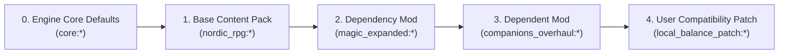
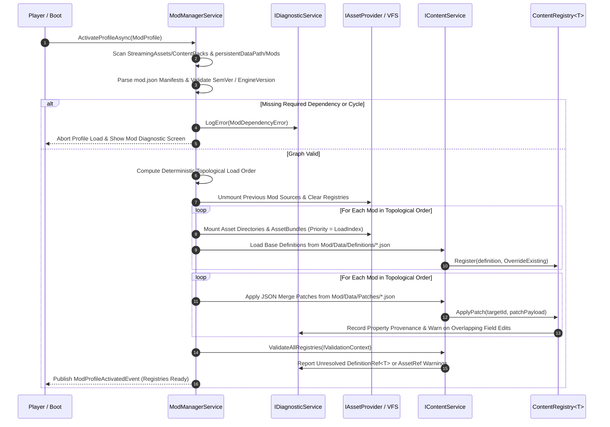

# FANTASY ENGINE — MODDING ARCHITECTURE SPECIFICATION
**Document ID**: `ARCH-04`  
**Layer**: Layer A (Engine Core Mod Loader) ↔ Layer C (User Mods & Content Packs)  
**Status Labels**: `EXISTING` | `TRANSITIONAL` | `PROPOSED` | `UNRESOLVED`

---

## 1. Executive Purpose

Modding is a first-class architectural pillar of the Fantasy Engine. Even the default games shipped with the engine (**Nordic RPG Proving Ground** and **The Silent Canopy**) are structured as base **Content Packs** loaded through the exact same manifest, validation, and registry pipeline that community mods use.

---

## 2. The Four Extension Tiers

Not all mods require the same privileges or complexity. The engine strictly separates mods into four explicit capability tiers:

| Tier | Name | Contents | Requires Unity Editor? | Security & Sandboxing Profile |
|---|---|---|---|---|
| **Tier 1** | **Data-Only Mods** | JSON definitions (`items/`, `skills/`, `factions/`, `quests/`, `recipes/`, `loot_tables/`) and JSON patches. | **No** (Any text editor or In-Game Editor) | **100% Safe**. Parsed by schema-validated JSON deserializer; zero executable code. |
| **Tier 2** | **Asset Mods** | Raw `.png` icons/textures, `.ogg`/`.wav` audio, `.glb`/`.gltf` 3D meshes, or compiled Unity AssetBundles. | **No** for `.png`/`.ogg`/`.glb`; **Yes** (Mod SDK) for custom ShaderGraph/VFX AssetBundles. | **Safe**. Loaded through `IAssetProvider` with memory quotas and fallback validation. |
| **Tier 3** | **World & Campaign Mods** | Custom levels, dungeons, placed props, NPC spawns, and wired interactable graphs exported from `CreatorStudioService`. | **No** (Authored directly in the In-Game Editor) | **100% Safe**. Serialized as `WorldAuthoringData` JSON documents. |
| **Tier 4A** | **Declarative Scripted Mods (Default Scripting)** | Event-condition-action trigger graphs (`DynamicTriggerEvent` -> conditions -> actions) and AI Behavior Tree configs. | **No** | **100% Safe & Sandboxed**. Executes within the engine's deterministic action interpreter with loop-count limits. |
| **Tier 4B** | **Native C# Plugin Assemblies (`TrustedAssembly`)** | Compiled `.dll` implementing `IEngineModule` or custom `IGameService` / `GameEvent` hooks. | **Yes** (C# IDE / .NET SDK) | **Unrestricted / Requires Explicit User Trust**. Full .NET `System.IO` / reflection access; disabled by default unless the user accepts the **Trusted Code Warning** in Mod Manager. |

### Why Arbitrary C# DLL Loading Is NOT the Default Scripting Tier
Allowing mods to load raw `.dll` files via `Assembly.LoadFrom` grants unrestricted OS-level file and network access (`System.IO.File.Delete`, `System.Net.HttpClient`), poses malware risks when players download community mods, and breaks whenever internal C# signatures change.
- **Architectural Solution**: 95% of gameplay scripting (custom spell effects, trap triggers, quest stage transitions, dialogue branches, custom skill XP triggers) is handled by **Tier 4A Declarative Action Schemas** (inspired by Makinom schematics and Behavior Designer tasks).
- **Tier 4B (`TrustedAssembly`)** is reserved for deep total-conversion overhaul teams and requires:
  1. `"requiresTrustedExecution": true` in `mod.json`.
  2. Assembly signature/hash verification and an explicit user confirmation prompt before loading.

---

## 3. `mod.json` Manifest Specification (`PROPOSED`)

Every Content Pack and Mod resides in its own directory containing a root `mod.json` file:
- **Built-In Content Packs**: `<Application.streamingAssetsPath>/ContentPacks/<pack_id>/mod.json`
- **User / Community Mods**: `<Application.persistentDataPath>/Mods/<mod_id>/mod.json`

### Example `mod.json` Manifest
```json
{
  "$schema": "https://fantasyengine.local/schemas/mod_manifest.v1.json",
  "manifestVersion": 1,
  "modId": "companions_overhaul",
  "displayName": "Companions & Silver Hand Overhaul",
  "author": "JostinStudio",
  "version": "1.2.0",
  "description": "Adds the Silver Hand faction, new ebony weaponry, necromancy skill, and radiant werewolf hunting quests.",
  "engineVersion": ">=0.5.0 <2.0.0",
  "tier": "WorldAndAssetMod",
  "requiresTrustedExecution": false,
  "dependencies": [
    {
      "modId": "nordic_rpg",
      "versionRange": "^1.0.0",
      "optional": false
    },
    {
      "modId": "weather_ realism_pack",
      "versionRange": ">=1.0.0",
      "optional": true
    }
  ],
  "loadOrder": {
    "loadAfter": ["nordic_rpg"],
    "loadBefore": ["ui_sorting_patch"]
  },
  "mounts": {
    "definitionsPath": "Data/Definitions",
    "patchesPath": "Data/Patches",
    "assetsPath": "Assets",
    "assetBundlesPath": "Bundles",
    "worldsPath": "Worlds"
  }
}
```

---

## 4. Dependency Graph Resolution & Load Order Rules

When a player activates a **Mod Profile**, `ModManagerService` computes a deterministic load order before mounting any files:



### Deterministic Load Order Algorithm
1. **Manifest Validation**: Verify every enabled mod in `ModProfile` has a valid `modId` (`[a-z0-9_]+`), valid SemVer `version`, and satisfies `engineVersion`.
2. **Dependency Verification**:
   - For each required dependency (`optional: false`), verify the target `modId` is enabled and its `version` satisfies `versionRange`.
   - For each optional dependency (`optional: true`), if the target `modId` is enabled, add a directed ordering edge `Target -> Dependent`.
3. **Explicit Load Order Hints**:
   - `loadAfter: ["mod_x"]` adds a directed edge `mod_x -> current_mod`.
   - `loadBefore: ["mod_y"]` adds a directed edge `current_mod -> mod_y`.
4. **Topological Sort with Profile Tie-Breaking**:
   - Run Kahn's algorithm using a priority queue keyed by the user's explicit index in `ModProfile.Mods`.
   - This guarantees **100% reproducible load order** across machines and sessions.

---

## 5. Override vs. Patch Semantics & Conflict Detection

When Mod B modifies content introduced by Base Pack A (`nordic_rpg:item/iron_sword`), two distinct mechanisms are supported:

### A. Full Definition Override (`Data/Definitions/`)
If Mod B defines an entry with `"id": "nordic_rpg:item/iron_sword"` in `Data/Definitions/`, `ContentRegistry<ItemDefinition>` replaces the entire `ItemDefinition` object (`RegistrationPolicy.OverrideExisting`) and appends `"companions_overhaul"` to the definition's `_overrideProvenance` list.
- **Conflict Risk**: If Mod B changes `iron_sword`'s `baseDamage` and Mod C changes `iron_sword`'s `baseValue` via full replacement, Mod C will overwrite Mod B's `baseDamage` change!

### B. Granular Field Patching (`Data/Patches/` — Recommended for Compatibility)
To allow multiple mods to tweak different fields of the same item, faction, or loot table without conflicting, `ModManagerService` supports **JSON Merge Patches** in `Data/Patches/`:

```json
{
  "targetRegistry": "framework:items",
  "targetId": "nordic_rpg:item/iron_sword",
  "operation": "merge",
  "patch": {
    "baseValue": 45,
    "fragments": {
      "weapon": {
        "baseDamage": 18
      }
    }
  }
}
```
- **Property-Level Conflict Detection**: `ModManagerService` tracks which mod modified which JSON path (`nordic_rpg:item/iron_sword -> fragments.weapon.baseDamage`).
- **Benign Merge**: Mod B patches `baseDamage` and Mod C patches `baseValue` -> both apply cleanly with **zero conflict**.
- **True Conflict Warning**: Mod B and Mod C both patch `fragments.weapon.baseDamage` -> `IDiagnosticService` logs a `PropertyOverrideConflict` showing the winning mod (Mod C) and the overridden mod (Mod B) in the Mod Manager UI.

---

## 6. Mod Profiles & Save Compatibility

### `ModProfile` Data Structure (`PROPOSED`)
```csharp
namespace Core.Modding
{
    using System;
    using System.Collections.Generic;

    [Serializable]
    public sealed class ModProfileEntry
    {
        public string ModId;
        public string Version;
        public string ContentHash; // SHA-256 of mod.json + definition files for integrity checking
        public bool Enabled = true;
    }

    [Serializable]
    public sealed class ModProfile
    {
        public string ProfileId = "default";
        public string DisplayName = "Default Loadout";
        public List<ModProfileEntry> Entries = new();
    }
}
```

### Hot-Swapping Profiles Without Restarting the Application
Because `ContentRegistry<T>` tracks `SourceModId` and `ModuleHost` separates `EngineGlobal` services from `SessionScoped` state:
1. When the player switches Mod Profiles in the Main Menu, `ModManagerService` unmounts the previous profile's `IAssetMountSource`s.
2. `IContentService` increments `Generation` and rebuilds all `ContentRegistry<T>` instances from the new profile's topological load order.
3. No application restart is required for Tier 1, Tier 2, Tier 3, or Tier 4A mods.

---

## 7. Workflow B: Complete Sequence for Loading a Mod Collection


