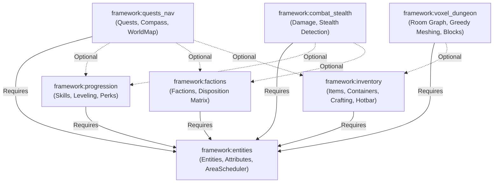
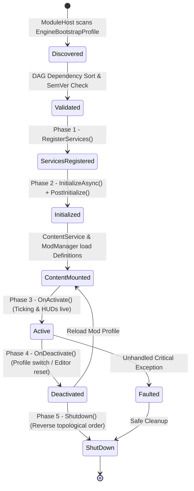
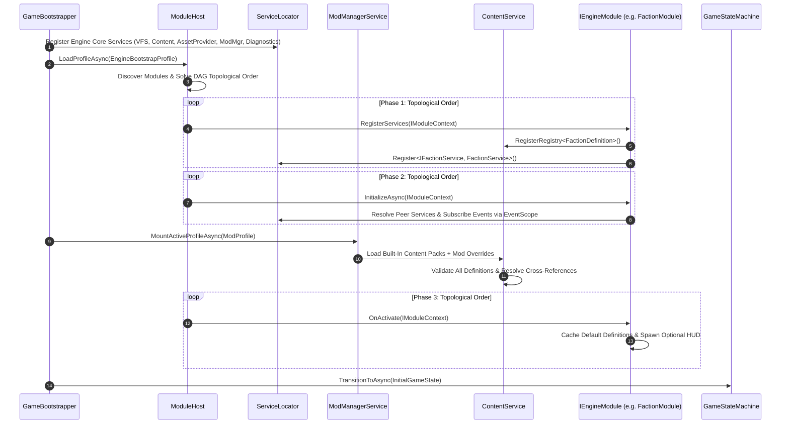

# FANTASY ENGINE — MODULE LIFECYCLE & COMPOSITION SPECIFICATION
**Document ID**: `ARCH-02`  
**Layer**: Layer A (Engine Core) ↔ Layer B (Fantasy Framework)  
**Status Labels**: `EXISTING` | `TRANSITIONAL` | `PROPOSED` | `UNRESOLVED`

---

## 1. Executive Purpose

In a modular Fantasy Engine, gameplay capabilities (Skills, Factions, Quests, Stealth, Voxel Generation, Crafting, Survival Needs) must not be hardcoded into the engine's startup routine. Instead, capabilities are packaged as self-contained **Engine Modules (`IEngineModule`)** with explicit dependencies, deterministic initialization phases, and clean teardown semantics.

---

## 2. The `IEngineModule` Contract (`PROPOSED`)

### Ownership & Responsibility
- **Owned By**: `Core.Modules` (Engine Core).
- **Implemented By**: Every Fantasy Framework subsystem (`ProgressionModule`, `FactionModule`, `QuestModule`, `CombatStealthModule`, `InventoryCraftingModule`, `VoxelDungeonModule`) and any optional C# plugin extension.

```csharp
namespace Core.Modules
{
    using System.Collections.Generic;
    using System.Threading;
    using System.Threading.Tasks;
    using Core.Content;

    /// <summary>
    /// PROPOSED: Declares a required or optional dependency on another module.
    /// </summary>
    public readonly struct ModuleDependency
    {
        public readonly ResourceId TargetModuleId;
        public readonly string VersionRange; // SemVer range, e.g., "^1.0.0"
        public readonly bool IsOptional;     // If true, loads after TargetModuleId if present, but does not fail if absent

        public ModuleDependency(ResourceId targetId, string versionRange = "*", bool isOptional = false)
        {
            TargetModuleId = targetId;
            VersionRange   = versionRange;
            IsOptional     = isOptional;
        }
    }

    /// <summary>
    /// PROPOSED: Runtime state of an IEngineModule managed by ModuleHost.
    /// </summary>
    public enum ModuleState
    {
        Discovered        = 0,
        ServicesRegistered = 1,
        Initializing      = 2,
        Initialized       = 3,
        Active            = 4,
        Deactivated       = 5,
        Faulted           = 6,
        ShutDown          = 7
    }

    /// <summary>
    /// PROPOSED: Context provided to modules during lifecycle transitions.
    /// Automatically scopes event subscriptions and content registries to the module.
    /// </summary>
    public interface IModuleContext
    {
        ResourceId ModuleId { get; }
        IServiceRegistry Services { get; }
        IContentService Content { get; }
        IDiagnosticService Diagnostics { get; }
        /// <summary>Event scope that automatically unsubscribes all listeners if the module deactivates or faults.</summary>
        IEventScope EventScope { get; }
    }

    /// <summary>
    /// PROPOSED: Fundamental unit of feature composition in the Fantasy Engine.
    /// </summary>
    public interface IEngineModule
    {
        /// <summary>Unique namespaced identifier (e.g., 'framework:progression').</summary>
        ResourceId ModuleId { get; }

        /// <summary>Human-readable display name.</summary>
        string DisplayName { get; }

        /// <summary>Semantic version of the module (e.g., '1.0.0').</summary>
        string Version { get; }

        /// <summary>Required and optional module dependencies.</summary>
        IReadOnlyList<ModuleDependency> Dependencies { get; }

        /// <summary>
        /// Phase 1: Register IGameService instances and ContentRegistry<T> types.
        /// DO NOT resolve peer services or load assets in this phase.
        /// </summary>
        void RegisterServices(IModuleContext context);

        /// <summary>
        /// Phase 2: Resolve peer services, subscribe to events via context.EventScope,
        /// and register default schemas/validators.
        /// </summary>
        Task InitializeAsync(IModuleContext context, CancellationToken cancellationToken);

        /// <summary>
        /// Phase 3: Called after all modules and active Content/Mod packs are loaded into registries.
        /// Spawn required HUD views or activate runtime simulation hooks.
        /// </summary>
        void OnActivate(IModuleContext context);

        /// <summary>
        /// Phase 4: Called when switching profiles or unloading a session.
        /// Pause simulation and release session-scoped state.
        /// </summary>
        void OnDeactivate(IModuleContext context);

        /// <summary>
        /// Phase 5: Final teardown on application exit or module unload (called in reverse dependency order).
        /// </summary>
        void Shutdown(IModuleContext context);
    }
}
```

---

## 3. Standard Fantasy Framework Modules & Dependency Graph

How the existing codebase's services map into modular `IEngineModule` units:

| Module ID | Services Encapsulated (`EXISTING` / `TRANSITIONAL`) | Content Registries Owned (`PROPOSED`) | Required Dependencies | Optional Dependencies |
|---|---|---|---|---|
| `core:editor_studio` | `CreatorStudioService`, `LabService`, `CuratorService` | `ContentRegistry<CreatorItemDefinition>`, `ContentRegistry<LabParameterGroup>` | *(None — Core)* | *(None)* |
| `framework:entities` | `AreaSchedulerService`, `PlayerSpawnService` | `ContentRegistry<EntityDefinition>`, `ContentRegistry<AttributeDefinition>` | *(None)* | *(None)* |
| `framework:inventory` | `HotbarService`, `CraftingService` | `ContentRegistry<ItemDefinition>`, `ContentRegistry<CraftingRecipeDefinition>`, `ContentRegistry<LootTableDefinition>` | `framework:entities` | *(None)* |
| `framework:factions` | `FactionService` | `ContentRegistry<FactionDefinition>` | `framework:entities` | *(None)* |
| `framework:progression` | `SkillProgressionService` | `ContentRegistry<SkillDefinition>`, `ContentRegistry<PerkDefinition>` | `framework:entities` | *(None)* |
| `framework:combat_stealth` | `StealthDetectionService` | `ContentRegistry<DamageTypeDefinition>`, `ContentRegistry<SpellDefinition>` | `framework:entities` | `framework:progression`, `framework:factions` |
| `framework:quests_nav` | `RadiantQuestService`, `CompassService`, `WorldMapService` | `ContentRegistry<QuestTemplateDefinition>`, `ContentRegistry<POIDefinition>` | `framework:entities` | `framework:progression`, `framework:factions`, `framework:inventory` |
| `framework:voxel_dungeon` | `LevelGenerationService`, `GreedyMeshingService`, `GridInteractionService`, `BlockPlacementService` | `ContentRegistry<BlockDefinition>`, `ContentRegistry<RoomArchetypeDefinition>` | `framework:entities` | `framework:inventory` |



---

## 4. Handling Optional Module Dependencies Cleanly

Look at how [`BaseActor.TakeDamage()`](file:///d:/Development/Game%20Development/3D%202D%20World/Assets/Scripts/Gameplay/Entities/BaseActor.cs#L159-L171) currently works:
```csharp
if (Core.ServiceLocator.TryGet<Systems.Skyrim.StealthDetectionService>(out var stealth) && ...)
{
    ...
    if (Core.ServiceLocator.TryGet<Systems.Skyrim.SkillProgressionService>(out var skillProg))
    {
        skillProg.AwardXP(Domain.Skyrim.SkyrimSkill.Sneak, 15f);
    }
}
```
Notice that even though `TryGet` makes the runtime call optional, `BaseActor.cs` still has a **compile-time dependency** on `Systems.Skyrim.SkillProgressionService` and `Domain.Skyrim.SkyrimSkill.Sneak`!

### The Architectural Fix: Event-Driven Inversion of Control
1. `BaseActor` (in `framework:entities` / `framework:combat_stealth`) **never** calls `SkillProgressionService`.
2. Instead, `BaseActor` publishes `SneakAttackTriggeredEvent(instigator, target, multiplier, finalDamage)` via `GameEventManager`.
3. If `framework:progression` is active, `SkillProgressionService` subscribes to `SneakAttackTriggeredEvent` and awards XP to the skill configured with tag `"stealth_attack"`!
4. If `framework:progression` is disabled (e.g., in a pure action dungeon crawler with no skill leveling), `BaseActor` still functions 100% identically without a single line of progression code referenced.

---

## 5. Deterministic 6-Stage Lifecycle State Machine



### Detailed Stage Semantics

1. **Stage 0 — Discovery & Topological Sort (`Discovered` → `Validated`)**:
   - `ModuleHost` reads `EngineBootstrapProfile.BuiltInModuleIds` and any trusted plugin modules enabled in the active `ModProfile`.
   - Builds a Directed Acyclic Graph (DAG) using both required and optional `ModuleDependency` edges.
   - Runs **Kahn's Topological Sort Algorithm**:
     - If a required dependency is missing -> halts module activation and logs `ModuleMissingDependencyError`.
     - If a cycle is detected (`ModuleA -> ModuleB -> ModuleA`) -> halts and logs `CircularModuleDependencyError` with the exact cycle path.
2. **Stage 1 — Service & Registry Registration (`ServicesRegistered`)**:
   - `ModuleHost` calls `module.RegisterServices(context)` in topological order.
   - Modules register their `IGameService` implementations into `IServiceRegistry` and declare their `ContentRegistry<T>` types in `IContentService`.
   - *Rule*: No service may call `ServiceLocator.Get<T>()` during Stage 1.
3. **Stage 2 — Initialization (`Initialized`)**:
   - `ModuleHost` calls `IGameService.Initialize()` on all registered services, followed by `module.InitializeAsync(context, token)` in topological order.
   - Services wire up event listeners via `context.EventScope.AddListener<T>(...)` and resolve peer service references via `ServiceLocator.Get<T>()` or `ServiceLocator.TryGet<T>()`.
4. **Stage 3 — Content & Mod Mounting (`ContentMounted`)**:
   - Before gameplay begins, `ModManagerService` and `ContentService` load all built-in content packs and active user mods into the `ContentRegistry<T>` instances registered in Stage 1.
   - Schema validation and cross-reference checks execute here.
5. **Stage 4 — Activation (`Active`)**:
   - `ModuleHost` calls `module.OnActivate(context)` in topological order.
   - Services that implement `ITickable` are added to `TickScheduler`.
   - Modules instantiate or bind their optional UI HUDs via `EnsureHUD`.
6. **Stage 5 — Deactivation & Shutdown (`Deactivated` → `ShutDown`)**:
   - When switching Mod Profiles or quitting, `ModuleHost` iterates modules in **reverse topological order** (dependents shut down before their dependencies).
   - `context.EventScope.Dispose()` automatically strips any lingering event subscriptions, preventing memory leaks and zombie callbacks.

---

## 6. Workflow A: Complete Sequence for Loading a Game



---

## 7. Failure Isolation Policy

If an optional module throws an exception during `InitializeAsync` or `OnActivate`:
1. `ModuleHost` catches the exception, marks the module `ModuleState.Faulted`, and disposes its `IEventScope` and registered services.
2. `ModuleHost` checks if any downstream module has a **required** dependency on the faulted module:
   - If only optional dependents exist, the engine logs a prominent warning in `IDiagnosticService` and continues booting the remaining modules.
   - If a required dependent exists, `ModuleHost` cascades the fault to that dependent and transitions the engine to a safe diagnostic recovery screen rather than crashing to desktop.
