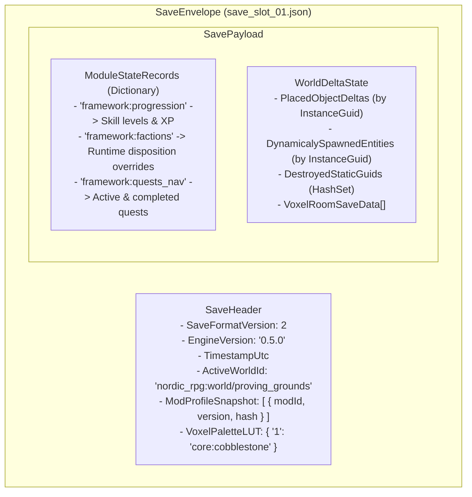
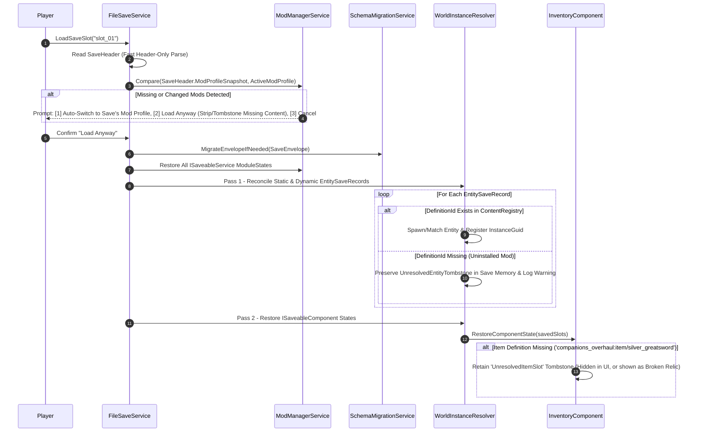

# FANTASY ENGINE — PERSISTENCE & SERIALIZATION ARCHITECTURE SPECIFICATION
**Document ID**: `ARCH-06`  
**Layer**: Layer A (Engine Core Persistence Infrastructure) ↔ Layer B & C (Modular State & Mod Compatibility)  
**Status Labels**: `EXISTING` | `TRANSITIONAL` | `PROPOSED` | `UNRESOLVED`

---

## 1. Executive Purpose

In a moddable Fantasy Engine where modules (Skills, Factions, Quests, Voxel Terrain, Survival Needs) can be added, removed, or reconfigured, the persistence system **cannot** rely on a single rigid `EntitySaveData` struct with hardcoded fields.

Furthermore, save files must survive:
- Mod load order changes or minor mod version updates.
- Missing mods or missing item/entity definitions (graceful degradation without corrupting the save file).
- Unexpected power loss or crashes during disk write (atomic file replacement).

---

## 2. Verification of Existing Persistence Implementations

| Existing Class | File Path | Status | Verified Behavior & Architectural Flaws |
|---|---|---|---|
| `FileSaveService` | [`Assets/Scripts/Systems/Persistence/FileSaveService.cs`](file:///d:/Development/Game%20Development/3D%202D%20World/Assets/Scripts/Systems/Persistence/FileSaveService.cs) | `TRANSITIONAL` | Writes `LevelSaveData` to a single hardcoded path (`Application.persistentDataPath/save_game.json`) via `JsonUtility.ToJson`. **Flaws**: No save slots, no atomic temp-file swap, no mod profile header, and `JsonUtility` silently drops dictionaries and polymorphic types. |
| `SaveData` (`LevelSaveData`, `EntitySaveData`) | [`Assets/Scripts/Domain/Persistence/SaveData.cs`](file:///d:/Development/Game%20Development/3D%202D%20World/Assets/Scripts/Domain/Persistence/SaveData.cs) | `TRANSITIONAL` | Hardcodes `CurrentHealth`, `Level`, `Experience`, `InventorySlotSaveData[]`. **Flaws**: Does not save Skyrim skills (`SkillProgressionService`), faction disposition overrides (`FactionService`), active quests (`RadiantQuestService`), or chest unlock states! |
| `BaseActor.OnEntityStateLoaded` | [`Assets/Scripts/Gameplay/Entities/BaseActor.cs`](file:///d:/Development/Game%20Development/3D%202D%20World/Assets/Scripts/Gameplay/Entities/BaseActor.cs#L70-L110) | `TRANSITIONAL` | Matches saved state to scene actors via `evt.State.InstanceId == name` (line 76) and resolves items via `Resources.Load("Definitions/ItemData/" + id)` (line 106). **Flaws**: Fails if two enemies share a GameObject name or if items come from a mod. |

---

## 3. Comprehensive Serializer Comparison & Recommendation

A core architectural decision is selecting the serialization technology for **Content/Mod JSON Files**, **In-Game Editor World Files**, and **Runtime Save Game Files**.

| Criterion | `UnityEngine.JsonUtility` (`EXISTING`) | `Newtonsoft.Json` (`PROPOSED PRIMARY`) | `Odin Serializer` (`INSTALLED IN PLUGINS`) | `Crystal Save` (`INSTALLED IN PLUGINS`) |
|---|---|---|---|---|
| **Dictionaries & Nested Collections** | ❌ **Unsupported** (Silently fails to serialize `Dictionary<K,V>`) | ✅ **Native Support** | ✅ **Native Support** | ✅ **Supported** |
| **Polymorphism / Interfaces (`IDefinitionFragment`)** | ❌ **Unsupported** (Requires `[SerializeReference]` with brittle Unity assembly/class renames) | ✅ **Clean Custom Converters** (Discriminator tag `"$type": "weapon"` decoupled from C# assembly names) | ⚠️ **Fragile for Mods** (Embeds full C# `AssemblyQualifiedName` in JSON/binary, breaking if namespaces refactor) | ⚠️ **Coupled to Unity Component IDs** |
| **Human Readability for Modders** | ✅ Clean JSON | ✅ **Gold Standard JSON** (Supports comments, trailing commas, schema validation) | ⚠️ Verbose metadata nodes (`$id`, `$type`) in JSON mode | ❌ Primarily Binary / Encrypted |
| **Unity Types (`Vector3`, `Quaternion`, `Color`)** | ✅ Native | ✅ Via lightweight `UnityStructConverters` | ✅ Native | ✅ Native |
| **Schema Migration / Version Tolerance** | ❌ Rigid | ✅ **`JObject` DOM Inspection** (Can inspect `schemaVersion` and transform JSON tree before deserializing) | ❌ Difficult on raw streams | ⚠️ Heavy custom setup |

### Architectural Decision
1. **Use `Newtonsoft.Json` (with custom `ResourceId`, `InstanceGuid`, `Vector3`/`Quaternion`, and `FragmentDiscriminator` converters)** for all **External Mod Definitions (`*.json`)**, **In-Game Editor Worlds (`WorldAuthoringData`)**, and **Save Game Envelopes (`SaveEnvelope`)**.
   - *Why*: Human-readable, supports JSON comments (`//`) for modders, serializes `Dictionary<string, string>` natively, and enables `JObject` pre-deserialization schema migration without coupling files to internal C# assembly/namespace names.
2. **Use `Odin Inspector`** inside the Unity Editor for rich developer inspector drawers (`[Searchable]`, `[TableList]`, custom `DefinitionRef<T>` dropdowns).

---

## 4. Extensible Save Data Architecture (`SaveEnvelope`)

Instead of a fixed `LevelSaveData` class that must be edited every time a new module is created, the persistence architecture uses a **Header + Modular Payload Envelope**:



### Proposed C# Contracts (`PROPOSED`)

```csharp
namespace Domain.Persistence
{
    using System;
    using System.Collections.Generic;
    using Core.Content;
    using Core.Modding;
    using Domain.Creator;

    /// <summary>
    /// PROPOSED: Implemented by any IEngineModule or IGameService that owns global session state
    /// (e.g., SkillProgressionService, FactionService, RadiantQuestService).
    /// </summary>
    public interface ISaveableService
    {
        ResourceId SaveStateKey { get; } // e.g., 'framework:progression'
        int CurrentStateSchemaVersion { get; }
        object CaptureState();
        void RestoreState(string serializedJsonState, int savedSchemaVersion);
    }

    /// <summary>
    /// PROPOSED: Implemented by any MonoBehaviour on an Actor, Container, or Interactable
    /// (e.g., AttributeComponent, InventoryComponent, ChestInteractable, LeverInteractable).
    /// </summary>
    public interface ISaveableComponent
    {
        string ComponentSaveKey { get; } // e.g., 'attributes', 'inventory', 'lockable_chest'
        object CaptureComponentState();
        void RestoreComponentState(string serializedJsonState, IWorldInstanceResolver resolver);
    }

    /// <summary>
    /// PROPOSED: Serialized state of a single entity or interactive world object.
    /// Matched deterministically via PersistentEntityComponent.InstanceId (InstanceGuid).
    /// </summary>
    [Serializable]
    public sealed class EntitySaveRecord
    {
        public InstanceGuid InstanceId;        // Unique persistent UUID
        public ResourceId DefinitionId;        // e.g., 'nordic_rpg:actor/draugr_boss'
        public bool IsDynamicallySpawned;      // True if spawned at runtime; false if part of base WorldAuthoringData
        public string RoomOrCellId;
        public float[] Position = new float[3];
        public float[] Rotation = new float[4];

        /// <summary>Map of ComponentSaveKey -> JSON payload for each ISaveableComponent on the entity.</summary>
        public Dictionary<string, string> ComponentStates = new();
    }

    /// <summary>
    /// PROPOSED: Top-level save file structure written atomically to disk.
    /// </summary>
    [Serializable]
    public sealed class SaveEnvelope
    {
        public int SaveFormatVersion = 2;
        public string EngineVersion = "0.5.0";
        public string SaveSlotName;
        public string SavedAtUtc;
        public ResourceId ActiveWorldId;
        public ModProfile ModProfileSnapshot;
        public Dictionary<ushort, string> VoxelPaletteMap = new();
        public Dictionary<string, string> ModuleStates = new();
        public List<EntitySaveRecord> Entities = new();
        public List<string> DestroyedStaticInstanceGuids = new();
    }
}
```

### How This Solves Existing Persistence Gaps
1. **Skills, Factions, and Quests are Automatically Saved**:
   - `SkillProgressionService` implements `ISaveableService` (`SaveStateKey = "framework:progression"`), serializing its `Dictionary<ResourceId, SkillRecord>` into `SaveEnvelope.ModuleStates["framework:progression"]`.
   - `FactionService` serializes `_overrides` into `SaveEnvelope.ModuleStates["framework:factions"]`.
   - `RadiantQuestService` serializes `_activeQuests` into `SaveEnvelope.ModuleStates["framework:quests_nav"]`.
2. **No More `InstanceId == gameObject.name` Bugs**:
   - Every saveable GameObject has a lightweight `PersistentEntityComponent` holding an `InstanceGuid`. When loading a save, `WorldInstanceResolver` matches `EntitySaveRecord.InstanceId` in O(1) dictionary lookup.
3. **Two-Pass Cross-Object Reference Restoration**:
   - **Pass 1**: Spawn all dynamically created entities and register all `InstanceGuid -> GameObject` mappings in `IWorldInstanceResolver`.
   - **Pass 2**: Invoke `ISaveableComponent.RestoreComponentState(..., resolver)` on all entities so any component holding an `InstanceGuid` reference to another entity (e.g., an NPC's current combat target or a lever's linked gate) resolves the live reference cleanly.

---

## 5. Save Compatibility, Missing Mods & Tombstone Envelopes

What happens when a player saves a game with `companions_overhaul` v1.2.0 enabled, then disables `companions_overhaul` or updates it to v1.3.0 and loads that save?

### Workflow F: Save Compatibility & Recovery Sequence



### Graceful Degradation Policies
1. **Unresolved Item / Entity Tombstones (Non-Destructive Loading)**:
   - Instead of permanently deleting an item from `InventoryComponent` when its mod is temporarily disabled, `InventorySlot` can hold an `UnresolvedItemRecord(ResourceId originalId, int count, string rawComponentJson)`. If the player re-enables the mod later, the item is still intact!
2. **Schema Migration Pipeline (`ISchemaMigrator`)**:
   - Every definition file and `SaveEnvelope` carries an integer `schemaVersion`.
   - If `savedVersion < currentVersion`, `SchemaMigrationService` runs registered `JObject -> JObject` upgrade steps (`v1 -> v2 -> v3`) before deserializing into the target C# class.
3. **Atomic Disk Write Safety**:
   - `FileSaveService.WriteData` **never** overwrites `save_slot_01.json` directly:
     1. Serialize to `save_slot_01.json.tmp`.
     2. Flush file stream and verify non-zero byte length.
     3. Copy existing `save_slot_01.json` to `save_slot_01.json.bak`.
     4. Atomically replace `save_slot_01.json` with `save_slot_01.json.tmp`.
   - If a crash occurs during step 1, the existing save and `.bak` file remain 100% uncorrupted.
