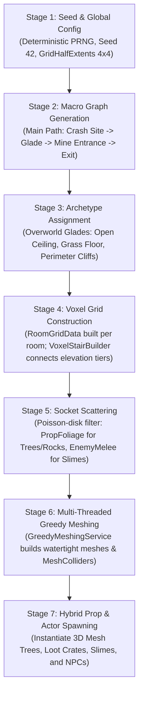

# Comprehensive Technical Audit & Production Plan: 3D 2D World
**Active Project Path**: `D:\Development\Game Development\3D 2D World`  
**Target Vision**: Fantasy Survival RPG (Finite Procedural Overworld, Hybrid Voxel/Mesh, Settlement Building, Recruitable NPCs, Underground Dungeons & Mines, Anime/Pixel-Art Aesthetic)  
**Audit Date**: October 2026  
**Auditor**: Antigravity Technical Director & Systems Architect

---

## 1. Executive Assessment

`D:\Development\Game Development\3D 2D World` is an **active, highly modular Unity 6 (`6000.3.8f1`) hybrid voxel-RPG foundation** built on Universal Render Pipeline (`17.3.0`), the New Input System (`1.18.0`), and UI Toolkit (`2.0.0`).

### Current Technical Baseline
Unlike an empty sandbox, this repository has already completed foundational engine stabilization and initial vertical-slice combat passes:
- **Core Architecture**: Clean `ServiceLocator`, typed `GameEventManager`, and `GameStateMachine` with a single centralized tick in `GameBootstrapper.cs`.
- **Procedural Level Generation**: Graph-based procedural generator (`RoomGraphGenerator`) producing connected room and corridor nodes with vertical floor tiers, room archetypes (`RaisedDais`, `StandardHall`, `SunkenArena`), and socket descriptors (`RoomSocket`).
- **Dynamic Greedy Meshing**: Runtime voxel grids (`RoomGridData`) meshed via multi-threaded Burst/Jobs (`GreedyMeshingService`, `GreedyMeshingJob`), with immediate real-time mesh and `MeshCollider` regeneration upon block modification.
- **Actor & Combat Pipeline**: Lossless float accumulation regeneration on attributes (`AttributeComponent` managing Health and Stamina), New Input System stamina-gated melee attacks (`WeaponComponent`), concrete `TakeDamage(DamageInfo)` on `BaseActor` with red hit reactions, and functional minion AI (`SlimeEntity` with idle, wander, chase, acid bite attack, and death squish).
- **Interaction & Inventory**: Raycast interaction controller (`PlayerInteractionController`), world item pickups (`BaseItem`), lootable containers (`BaseContainer`), and 20-slot stacking inventory (`InventoryComponent`).
- **Area Simulation & UI**: Manhattan-distance simulation scheduling (`AreaSchedulerService`) culling off-screen entities, alongside interactive real-time minimap/world-map HUDs (`WorldMapHUD`) rendered via UI Toolkit.
- **Build Health**: Compiles cleanly with **0 Warnings and 0 Errors** (`dotnet build "Assembly-CSharp.csproj"`).

### Suitability for the Target Fantasy Survival RPG
This project is **exceptionally well-positioned** to evolve into the desired fantasy survival RPG. Rather than a generic infinite voxel sandbox, its room-grid architecture, socket system, and native `CharacterController` already embody the **hybrid voxel/mesh philosophy**:
- Voxel grids serve as the editable floor/wall/stair structural substrate.
- Conventional meshes represent actors, items, and socketed props.
- Transitioning to an overworld involves generating open-sky biomes (glade/clearing archetypes) on the macro graph, while retaining underground dungeon rooms as subterranean nodes accessed via mine entrances.

---

## 2. Verified Capability Matrix

| System / Subsystem | Status | Evidence / File Path | Technical Reality & Gaps |
| :--- | :--- | :--- | :--- |
| **Unity & Platform** | IMPLEMENTED & VERIFIED | `ProjectSettings/ProjectVersion.txt`, `Packages/manifest.json` | Unity 6000.3.8f1, URP 17.3.0, Input System 1.18.0, UI Toolkit 2.0.0. `dotnet build` succeeds in 1.6s with 0 warnings and 0 errors. |
| **Core Architecture** | IMPLEMENTED & VERIFIED | `Assets/Scripts/Core/GameBootstrapper.cs`, `ServiceLocator.cs`, `GameEventManager.cs` | Central bootstrapper with deterministic lifecycle. Single central `ITickable` loop in `Update()` without duplicate execution. |
| **Input Pipeline** | IMPLEMENTED & VERIFIED | `Assets/Scripts/Systems/Input/InputManager.cs`, `Gameplay/Player/PlayerInputEvents.cs` | 100% New Input System bindings (`Move`, `Look`, `Jump`, `Run`, `Crouch`, `InteractPrimary`, `InteractSecondary`, `InteractUse`, `Hotbar`, `ToggleWorldMap`). Fully wired through event bus. |
| **Voxel Grid & Palettes** | IMPLEMENTED & VERIFIED | `Assets/Scripts/Domain/Grid/RoomGridData.cs`, `BlockRegistry.cs`, `BlockPalette.cs` | 3D flat ushort voxel array per room/corridor. 15 validated block definitions (`BLCK_0010` to `BLCK_0050`) supporting floor, wall, ceiling, and water roles across 3 palettes (`CastleBastion`, `ClassicCrypt`, `OvergrownCatacomb`). |
| **Greedy Meshing** | IMPLEMENTED & VERIFIED | `Assets/Scripts/Systems/Meshing/GreedyMeshingService.cs`, `GreedyMeshingJob.cs` | 2D greedy quad merging running in Burst/Jobs. Real-time sub-$16\,\text{ms}$ mesh and `MeshCollider` regeneration upon block destruction/placement. |
| **Voxel Interaction & Mining** | IMPLEMENTED & VERIFIED | `Assets/Scripts/Gameplay/Player/PlayerGridInteractor.cs`, `Systems/Interaction/BlockPlacementService.cs` | Center-screen raycasting highlights blocks with selector overlay. Left click breaks, right click places block from hotbar. Primary click decoupled from combat to prevent accidental mining during battle. |
| **Dungeon Generation** | IMPLEMENTED & VERIFIED | `Assets/Scripts/Domain/LevelGeneration/LevelGenerationData.cs`, `Gameplay/World/LevelLayoutRenderer.cs` | Seeded graph generator creating main paths, branches, cycles, and multi-tier floor levels with automated voxel stair generation (`VoxelStairBuilder.cs`). Sockets spawn player, slimes, and exits. |
| **Simulation Scheduler** | IMPLEMENTED & VERIFIED | `Assets/Scripts/Systems/Scheduler/AreaSchedulerService.cs` | Manhattan-distance room culling: Active ($\le 0$), Dormant ($1$), Purged ($\ge 3$). Disables off-screen physics/controllers and runs catch-up attribute regeneration. |
| **World Map & Minimap** | IMPLEMENTED & VERIFIED | `Assets/Scripts/Systems/WorldMap/WorldMapService.cs`, `Gameplay/UI/WorldMapHUD.cs` | UI Toolkit `VisualElement`-based map tracking room discovery, player position, entity pins, and corridor connections with zoom/pan. |
| **Player Character** | IMPLEMENTED & VERIFIED | `Assets/Scripts/Gameplay/Player/Player_Movement.cs`, `Player_CameraRig.cs` | Native Unity `CharacterController` with camera-relative movement, sprint, crouch, jump, ground-sticking, and auto-step offset ($1.05\,\text{m}$) for seamless voxel stair climbing. |
| **Actor Attributes** | IMPLEMENTED & VERIFIED | `Assets/Scripts/Gameplay/Entities/AttributeComponent.cs`, `BaseActor.cs`, `StatsComponent.cs` | Lossless sub-step float accumulation regeneration. Supports Health, Stamina, and Mana with combat multipliers. Initialized from `JackActorData.asset`. |
| **Combat Pipeline** | IMPLEMENTED & VERIFIED | `Assets/Scripts/Domain/Combat/DamageInfo.cs`, `Gameplay/Combat/WeaponComponent.cs`, `BaseActor.cs` | Concrete `TakeDamage(DamageInfo)` without speculative interfaces. Melee spherecast ($2.5\,\text{m}$ range, $0.6\,\text{m}$ radius), $20$ stamina cost, $25$ damage, red hit flash coroutine. |
| **Minion AI & Combat** | IMPLEMENTED & VERIFIED | `Assets/Scripts/Gameplay/Entities/SlimeEntity.cs`, `Assets/Prefabs/Entities/Slime.prefab` | Minion state machine: Idle, WanderHop, Chasing, Leaping. Executes $10$ Acid damage bite attack ($1.2\,\text{s}$ cooldown). On 0 HP, disables collider, squishes, and destroys entity. |
| **Item Interaction & Loot** | IMPLEMENTED & VERIFIED | `Assets/Scripts/Gameplay/Entities/BaseItem.cs`, `BaseContainer.cs`, `PlayerInteractionController.cs` | Raycast ($2.5\,\text{m}$) identifies `BaseEntity`, shows contextual prompt, and handles `E` key interaction. Items transfer to inventory and destroy world object; chests transfer stored contents. |
| **Inventory System** | IMPLEMENTED & VERIFIED | `Assets/Scripts/Domain/Inventory/InventorySlot.cs`, `Gameplay/Entities/InventoryComponent.cs` | 20-slot inventory with item stacking, capacity limits, `AddItem()`, `RemoveItem()`, and `InventoryChangedEvent`. |
| **Overworld Biomes** | PARTIALLY IMPLEMENTED | `Assets/Docs/PRODUCTION_BACKLOG.md` (TICK-05) | Backlog specifies open-ceiling `ForestClearing` and `ForestPond` archetypes with foliage sockets. Room archetypes currently represent enclosed halls and crypts. |
| **Persistence (Save/Load)** | PARTIALLY IMPLEMENTED | `Assets/Scripts/Systems/Persistence/FileSaveService.cs`, `Domain/Persistence/SaveData.cs` | Serializes `LevelSaveData` (`OriginalLayout`, room voxel arrays, entity positions). **Gap**: Does not yet serialize inventory slots, active quest steps, or modified chunk deltas. |
| **Resource Gathering** | MISSING | None | No harvestable trees/rocks that take axe/pickaxe hits and drop floating resources into the world. |
| **Crafting & Building** | MISSING | None | No recipe data structures, crafting queue/workbench, or placeable building pieces (walls, doors, beds). |
| **Recruitable NPCs** | MISSING | None | No humanoid NPC AI state machines, need meters, schedules, or recruitment dialogue trees. |
| **Quest System** | DOCUMENTED ONLY | `Assets/Docs/PRODUCTION_BACKLOG.md` (TICK-07) | Backlog defines `QuestManager`, `QuestStep`, and `QuestHUD`, but code is not yet written. |
| **Automated Tests** | MISSING | None in `Assets/` | `com.unity.test-framework` is installed, but no user EditMode or PlayMode test files currently exist in the project. |

---

## 3. Architecture Map & Dependencies

```mermaid
graph TD
    subgraph CoreEngine ["Core Infrastructure"]
        GB["GameBootstrapper\n(MonoBehaviour)"] --> SL["ServiceLocator\n(Registry)"]
        GB --> GEM["GameEventManager\n(Typed Bus)"]
        GB --> GSM["GameStateMachine\n(Playing, Paused)"]
        GB --> IM["InputManager\n(New Input System)"]
    end

    subgraph LevelPipeline ["Procedural Level Generation & Meshing"]
        LGS["LevelGenerationService"] --> RGG["RoomGraphGenerator\n(IRoomGraphGenerator)"]
        RGG --> LL["LevelLayout\n(Rooms, Corridors, Sockets)"]
        LLR["LevelLayoutRenderer"] --> LL
        LLR --> GMS["GreedyMeshingService\n(Burst Job)"]
        LLR --> BR["BlockRegistry\n(15 Block Definitions)"]
        GMS --> GMB["GridMeshBuilder\n(Mesh + MeshCollider)"]
        LLR --> VSB["VoxelStairBuilder\n(Tier Step Meshing)"]
    end

    subgraph WorldRuntime ["World Simulation & Runtime Services"]
        ASS["AreaSchedulerService\n(Active, Dormant, Purged)"]
        WMS["WorldMapService\n(Room Discovery & Pins)"]
        BPS["BlockPlacementService\n(Mine & Place Voxels)"]
        FSS["FileSaveService\n(LevelSaveData JSON)"]
    end

    subgraph ActorCombat ["Actor, Entity & Combat Pipeline"]
        BA["BaseActor\n(TakeDamage, Flash Reaction)"] --> AC["AttributeComponent\n(Health & Stamina Float Regen)"]
        BA --> SC["StatsComponent"]
        BA --> STC["StateComponent"]
        WC["WeaponComponent\n(Melee Spherecast, Stamina Cost)"] -.->|Deals DamageInfo| BA
        SE["SlimeEntity\n(Aggro, Acid Bite, Death Squish)"] --|> BA
    end

    subgraph InteractionInventory ["Interaction & Inventory Layer"]
        PIC["PlayerInteractionController\n(2.5m Raycast, E Key)"] --> BE["BaseEntity\n(OnInteract, Prompt)"]
        BI["BaseItem\n(Picks Up Item)"] --|> BE
        BC["BaseContainer\n(Transfers Items)"] --|> BE
        IC["InventoryComponent\n(20 Slots, Stacking)"]
        BI -.->|Transfers To| IC
        BC -.->|Transfers To| IC
    end

    subgraph PresentationUI ["Presentation & UI Layer"]
        HUD["HotbarHUD\n(UI Toolkit Slot Palette)"]
        WMH["WorldMapHUD\n(UI Toolkit VisualElement Map)"]
        CR["Player_CameraRig\n(First/Third-Person Orbit)"]
    end

    SL --> LGS
    SL --> ASS
    SL --> WMS
    SL --> BPS
    SL --> FSS
```

---

## 4. Reuse-Versus-Refactor Assessment

### A. Retain Unchanged (Core Strengths)
1. **`RoomGridData.cs` and `BlockRegistry.cs`**: Robust 3D voxel grid representation per room/corridor with ScriptableObject-backed block roles (Floor, Wall, Ceiling, Water).
2. **`GreedyMeshingService.cs` & `GreedyMeshingJob.cs`**: Highly optimized Burst-compiled meshing generating watertight geometry and direct `MeshCollider` assignments in sub-frame times.
3. **`GameBootstrapper.cs` & `ServiceLocator.cs`**: Strict phase-ordered service startup and centralized tick execution without duplicate updates.
4. **`AttributeComponent.cs`**: Lossless sub-step float accumulation attribute system ensuring accurate stamina and health regeneration under any frame rate.
5. **`WeaponComponent.cs` & `BaseActor.cs`**: Concrete peer-to-peer combat pipeline adhering to Jostin's constitutional rule of zero speculative interfaces.
6. **`AreaSchedulerService.cs` & `WorldMapService.cs`**: Production-ready room culling and real-time UI Toolkit map rendering.

### B. Retain with Adapter / Refactor
1. **`LevelLayoutRenderer.cs` & `RoomGraphGenerator.cs`**:
   - *Current*: Generates underground enclosed crypts and rooms with ceilings.
   - *Refactoring*: Implement **TICK-05** to introduce `ForestClearing` and `ForestPond` archetypes without ceilings, with grass floors and foliage sockets. This turns the graph generator into a hybrid **Overworld Glade + Underground Dungeon** generator.
2. **`PlayerGridInteractor.cs` & `BlockPlacementService.cs`**:
   - *Current*: Modifies dungeon blocks when clicked. Primary click is already decoupled from weapon combat.
   - *Refactoring*: Add a building tool check so block placement is only active when a construction hammer/block is selected in the hotbar.
3. **`FileSaveService.cs`**:
   - *Current*: Saves room grids and basic entity transforms.
   - *Refactoring*: Expand `LevelSaveData` to serialize player inventory slots, active quest state, and discovered map nodes.

### C. Genuinely Needs to Be Built (Target Game Expansion)
1. **Resource Gathering Nodes (`ResourceNode.cs`)**:
   - Harvestable low-poly trees and boulders that register `BaseEntity` interaction or take melee tool hits (`TakeDamage`), spawn floating resource items, and enter depleted states.
2. **Crafting System (`CraftingService.cs`, `CraftingRecipe.cs`)**:
   - Data-driven recipe registry converting raw materials (`Wood` $\to$ `Plank` $\to$ `Wooden Wall / Cot / Storage Chest`).
3. **Building & Placement Controller (`BuildingPlacementController.cs`)**:
   - Grid-snapped or freeform holographic ghost placement for furniture and structural pieces consuming inventory materials.
4. **Recruitable NPC Pipeline (`NpcEntity.cs`, `NpcScheduleComponent.cs`)**:
   - Humanoid NPC with daily schedule states (Wander $\to$ Work $\to$ Sleep), shelter requirement checks, recruitment quest evaluation, and dialogue prompts.
5. **Dungeon Entrance Transition (`MineEntrance.cs`)**:
   - Connecting overworld clearing sockets to underground dungeon instances via an entry transition volume.

---

## 5. Target Requirements Alignment

| Target Requirement | Current Project State | What Must Be Built / Changed |
|---|---|---|
| **Finite Seeded Overworld** | Seeded room-graph generator creates finite connected spaces with boundaries. | Add `ForestClearing` archetype with open ceilings, grass terrain, and perimeter cliff/forest barriers. |
| **Hybrid Voxel + Mesh** | Voxel floors/walls with socketed prefabs for player, slimes, and chests. | Expand socket spawner in `LevelLayoutRenderer` to instantiate low-poly 3D mesh trees, rocks, and foliage at `PropFoliage` sockets. |
| **Exploration & POIs** | Rooms track entry events (`RoomEnteredEvent`) and reveal on UI Toolkit minimap. | Add landmark archetypes (Ancient Shrine, Abandoned Camp, Sunken Pond) to room graph generator. |
| **Resource Gathering** | Items and containers exist, but no harvestable resource nodes. | Create `ResourceNode` component on tree/rock prefabs that drop `ItemData` upon tool hits. |
| **Inventory & Equipment** | 20-slot inventory, slot stacking, and equipped `WeaponComponent` functional. | Add equipment slot classification (Weapon, Tool, Armor) and hotbar item-holding visual representation. |
| **Crafting & Construction** | Voxel placement works via `BlockPlacementService`. | Add `CraftingService` (Wood $\to$ Planks) and placeable structural prefabs (Wall, Cot, Storage Crate). |
| **Recruitable NPCs** | Slime minion AI functional; actor stats and attributes fully hardened. | Create `NpcEntity` with recruitment quest checking for player-built shelter and dialogue prompt. |
| **Dungeons & Mines** | Full procedural dungeon room-and-corridor generator already exists. | Treat existing dungeon generation as the subterranean mine level; place mine shaft entrance in forest clearing. |
| **Save / Load Persistence** | `FileSaveService` saves room voxels and entity coordinates. | Extend save schema to include inventory contents, placed structures, and active quest progress. |
| **Anime-Inspired Visuals** | Pixel-art texture atlases, billboard sprites, and vertex colors in use. | Ensure low-poly 3D props use shared pixel-art textures and unlit/cel-shaded URP materials. |
| **Optional AI Narrative** | Event-driven architecture with clean service boundaries. | Implement authored quest state machine first; add optional asynchronous flavor-text generator with fallback. |

---

## 6. Minimum Playable Vertical-Slice Specification

### Slice Scope
- **Overworld**: Finite 5-clearing forest glade generated from Seed `42`:
  1. *Crash Site* (Spawn clearing with cargo crates and survival knife).
  2. *Woodland Glade* (Harvestable trees, stone outcroppings, and stranded woodsman NPC).
  3. *Forest Pond* (Sunken water pool with water blocks and sloped banks).
  4. *Abandoned Mine Entrance* (Entrance socket leading to underground crypt).
  5. *Mountain Pass* (Exit boundary).
- **Underground Mine**: 3-room catacomb instance populated by 2 Slime minions and an iron ore deposit.
- **Core Loop**:
  1. Awaken at Crash Site $\to$ pick up survival knife and rations from cargo crate.
  2. Explore into Woodland Glade $\to$ chop 3 mesh trees with axe/knife $\to$ collect 12 Wood items.
  3. Craft a workbench and build a primitive 4-piece wooden shelter (3 walls, 1 cot).
  4. Talk to the stranded woodsman NPC $\to$ complete recruitment quest $\to$ NPC claims the cot.
  5. Enter the Abandoned Mine $\to$ defeat 2 slimes using melee combat pipeline $\to$ mine iron ore.
  6. Return to camp $\to$ press F5 to save $\to$ restart game $\to$ verify 100% state recovery.

### Acceptance Criteria
1. **Generation Determinism**: Generating Seed `42` yields the exact same clearing layout, pond depth, and mine entrance position across multiple restarts.
2. **Hybrid Gathering**: Striking a mesh tree with a tool inflicts damage; at 0 HP, tree dissolves into 3 floating wood item pickups that vacuum into player inventory.
3. **Shelter Construction**: Player can place crafted wall pieces onto the voxel grid; structure persists and creates an enclosed shelter detection zone.
4. **NPC Recruitment**: Speaking with the woodsman displays dialogue prompt; fulfilling his wood/shelter requirement transitions him to "Recruited" state.
5. **Dungeon Traversal**: Interacting with the mine entrance smoothly transitions the player to the underground dungeon grid without deleting overworld state.
6. **Persistence Roundtrip**: Saving game mid-loop, quitting to desktop, and reloading restores player position, inventory items, placed walls, recruited NPC status, and defeated enemies.

---

## 7. World-Generation Design (Hybrid Glade/Dungeon Pipeline)



### Architectural Guarantees
- **No Infinite Voxel Bloat**: Generation is bounded by `GridHalfExtents` and connected corridors, ensuring strict memory control.
- **True Hybrid Composition**: Ground and terrain elevation are voxels (allowing mining, shoveling, and stair building). Vegetation, furniture, and actors are conventional 3D prefabs with `MeshRenderer` and `Collider`.

---

## 8. Dungeon & Mine Integration Plan

The project **already contains** a high-performance room-and-corridor generator (`RoomGraphGenerator`). Integrating underground mines requires zero external porting:

1. **Subterranean Room Tagging**:
   - Rooms generated with `FloorLevel < 0` or attached via a `SocketType.Exit` socket represent underground levels.
   - Underground rooms use the existing `ClassicCrypt` or `OvergrownCatacomb` palettes with solid ceiling voxels.
2. **Mine Shaft Transition**:
   - The overworld forest glade spawns an "Abandoned Mine Shaft" prefab at a `SocketType.Exit` socket.
   - Stepping into the shaft trigger fires a transition event that teleports the player to the start room of the underground catacomb.
3. **Area Scheduler Isolation**:
   - `AreaSchedulerService` automatically marks rooms further than 3 Manhattan steps as `AreaSimulationTier.Purged`, putting overworld enemies and entities to sleep while the player explores the underground mine.

---

## 9. Persistence & Testing Plan

### Unified Save Architecture (`FileSaveService`)
Expand `LevelSaveData` in [`SaveData.cs`](file:///D:/Development/Game%20Development/3D%202D%20World/Assets/Scripts/Domain/Persistence/SaveData.cs):
```csharp
[Serializable]
public class MasterSaveData
{
    public int WorldSeed;
    public float PlayTime;
    public EntitySaveData PlayerState;
    public List<InventorySlotSaveData> PlayerInventory;
    public List<PlacedStructureSaveData> PlacedStructures;
    public List<NpcSaveData> NpcStates;
    public List<RoomVoxelDeltaSaveData> ModifiedRooms;
    public List<string> DiscoveredRoomIds;
}
```

### Automated Verification Gates
1. **Compilation Gate**: `dotnet build "Assembly-CSharp.csproj"` must succeed with **0 Warnings and 0 Errors** before committing any change.
2. **Deterministic Layout Test (EditMode)**:
   - Call `RoomGraphGenerator.Generate()` twice with Seed `42`.
   - Assert room counts, coordinates, and connection pairs match exactly.
3. **Inventory Stacking Test (EditMode)**:
   - Add 15 Wood to a 10-stack limit slot; assert slot 0 contains 10, slot 1 contains 5.
4. **Combat Stamina Test (EditMode)**:
   - Reduce Stamina to 5; call `WeaponComponent.TryExecuteAttack()`; assert attack returns `false`.
5. **Persistence Roundtrip Test (EditMode)**:
   - Populate `MasterSaveData` with 1 player, 3 items, and 1 placed wall; serialize to JSON and deserialize; assert all fields match.

---

## 10. AI Narrative Plan (Optional & Staged)

1. **Deterministic Rule Layer (Always Active)**:
   - Quest progression is driven entirely by discrete typed events: `ItemCollectedEvent`, `StructurePlacedEvent`, `EnemyKilledEvent`.
   - Dialogue trees use authored ScriptableObjects (`DialogueData`) with branching node choices.
2. **Template Expansion Layer**:
   - Quests and NPC barks use parameterized fallback strings: `"[Name]: Thank you for building this shelter. I will help guard the perimeter."`
3. **Optional Generative Flavor Layer (Non-Blocking)**:
   - When an LLM service is configured, it receives only read-only narrative context (NPC archetype, player deeds, recent events) and outputs flavor dialogue.
   - Responses are strictly validated against JSON schema and clamped to 150 characters.
   - If the API times out ($> 500\,\text{ms}$) or fails validation, the authored template is displayed seamlessly.

---

## 11. Refactoring & Implementation Backlog

| Phase | Milestone / Objective | Key Files Affected | Test Gate / Acceptance Criteria |
|---|---|---|---|
| **Phase 1** | **`TICK-05`: Forest Biome Clearings & Prefab Sockets** | `LevelGenerationData.cs`, `RoomArchetype.cs`, `LevelLayoutRenderer.cs`, `ForestClearing.asset` | Open-sky glades generate without ceiling voxels; conventional 3D tree prefabs instantiate at foliage sockets. |
| **Phase 2** | **Resource Gathering Nodes & Drops** | `ResourceNode.cs`, `ItemData.cs`, `BaseItem.cs`, `DamageInfo.cs` | Striking a mesh tree with weapon/tool deals damage and spawns collectible wood item pickups. |
| **Phase 3** | **Crafting & Settlement Building** | `CraftingService.cs`, `CraftingRecipe.cs`, `BuildingPlacementController.cs` | Player crafts Wood $\to$ Planks and places a wooden wall/bed on the grid consuming inventory resources. |
| **Phase 4** | **`TICK-06`: Corrupted Tree Spirit Boss Encounter** | `TreeSpiritEntity.cs`, `TreeSpirit.prefab`, `TreeSpiritActorData.asset` | Boss awakens upon player approach, performs telegraph root spike attacks, and drops quest heart upon defeat. |
| **Phase 5** | **`TICK-07`: Quest State Machine & Objective Tracking** | `QuestState.cs`, `QuestEvents.cs`, `QuestManager.cs`, `QuestHUD.cs` | Objective HUD guides player through crash scavenge, wood gathering, shelter building, and boss defeat. |
| **Phase 6** | **Recruitable NPC & Living Conditions** | `NpcEntity.cs`, `NpcScheduleComponent.cs`, `DialogueController.cs` | Stranded woodsman evaluates shelter quality, accepts recruitment quest, and claims placed bed. |
| **Phase 7** | **`TICK-08` & `TICK-09`: Vertical Slice Integration & Persistence** | `FileSaveService.cs`, `SaveData.cs`, `LevelLayoutRenderer.cs`, `SampleScene.unity` | Full 30-minute playable loop verified; complete world, inventory, quest, and building state persists across saves. |

---

## 12. Open Architectural Decisions for Your Review

1. **Overworld Graph Topology**:
   - *Option A (Recommended)*: Evolve the existing room-and-corridor generator into an **Overworld Glade Network** (large outdoor clearings connected by forest trails and mountain canyons). This reuses 100% of your existing meshing, scheduling, and minimap code.
   - *Option B*: Implement a secondary continuous 2D heightmap chunk engine exclusively for the overworld, retaining the room generator only for underground dungeons.
   - *Recommendation*: **Option A** avoids architectural duplication, delivers the game months faster, and naturally creates interesting, handcrafted-feeling procedural clearings with distinct points of interest.

2. **Resource Gathering Mechanics**:
   - *Option A (Recommended)*: Resource nodes (trees, boulders) use the same concrete `BaseActor` / `TakeDamage` pipeline as enemies, reacting to physical damage from tools with red flashes and health depletion.
   - *Option B*: Create a dedicated `IHarvestable` interface specifically for gathering.
   - *Recommendation*: **Option A** maintains Jostin's constitutional rule of zero speculative interfaces and reuses your hardened combat code.

3. **Building Construction Style**:
   - *Option A (Recommended)*: Hybrid construction where terrain terraforming uses voxel placement (`BlockPlacementService`), while furniture, walls, and crafting benches use conventional 3D modular prefabs placed on a half-meter or integer-grid snap.
   - *Option B*: Represent all buildings purely as voxels.
   - *Recommendation*: **Option A** delivers the target anime-inspired aesthetic with detailed furniture models while preserving terrain terraforming.
