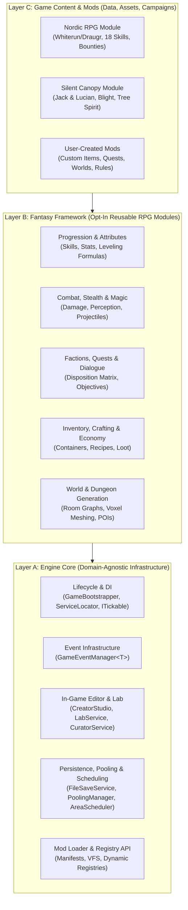
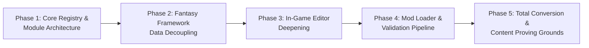

# RPG PROJECT — ENGINE DESIGN READINESS & ARCHITECTURAL REASSESSMENT
**Document Role**: Principal Engine Architect & Systems Auditor Assessment  
**Core Mandate**: Strategic reassessment of the project as a **Modular, Data-Driven Fantasy Engine** with extensive modding and in-game editor capabilities.  
**Classification Standard**: `ENGINE CORE` | `FANTASY FRAMEWORK` | `GAME CONTENT` | `PREREQUISITE` | `RISK`

---

## 1. Updated Project Identity

### From Single Game to Reusable Fantasy Engine
Earlier documentation and prototypes treated the project variously as a *2.5D Voxel Dungeon Crawler*, a *Portal Survival Adventure ("Jack & Lucian: The Silent Canopy")*, or a *Skyrim-inspired Action RPG*.

**Canonical Project Vision**:
The project is a **modular, extensible, data-driven Fantasy Engine** designed so developers, designers, and modders can build, configure, extend, and share RPG worlds, rulesets, and campaigns without modifying the core C# source code.

Under this vision, the existing implementations are no longer conflicting creative pivots—they are **distinct Game Content Modules and Proving Grounds** exercising different capabilities of the same underlying engine:
1. **Skyrim-Style Nordic RPG (`RPGProvingGrounds.unity`)**: Proving ground for 3D modular architecture, "learn by doing" skill progression, faction politics, stealth perception, lockpicking, and radiant quests.
2. **The Silent Canopy ("Jack & Lucian")**: Narrative/survival proving ground for stamina-driven combat, environmental scavenging, and boss encounters.
3. **Voxel Crawler & Creator Studio**: Proving ground for procedural room-graph generation, runtime greedy meshing, and live in-game level editing.

---

## 2. Engine vs. Framework vs. Game Content (Three-Layer Architecture)

To achieve true modularity and moddability, the codebase is evaluated across three strict architectural layers:

### Layer A: Engine Core (`Assets/Scripts/Core/` & Foundational `Systems/`)
Domain-agnostic runtime infrastructure that knows nothing about swords, dragons, or skills:
- **Bootstrapping & Lifecycle**: [`GameBootstrapper.cs`](file:///d:/Development/Game%20Development/3D%202D%20World/Assets/Scripts/Core/GameBootstrapper.cs), [`IGameService.cs`](file:///d:/Development/Game%20Development/3D%202D%20World/Assets/Scripts/Core/IGameService.cs), [`ITickable.cs`](file:///d:/Development/Game%20Development/3D%202D%20World/Assets/Scripts/Core/ITickable.cs), [`GameStateMachine.cs`](file:///d:/Development/Game%20Development/3D%202D%20World/Assets/Scripts/Domain/StateMachine/GameStateMachine.cs).
- **Service Resolution**: [`ServiceLocator.cs`](file:///d:/Development/Game%20Development/3D%202D%20World/Assets/Scripts/Core/ServiceLocator.cs).
- **Typed Event Bus**: [`GameEventManager.cs`](file:///d:/Development/Game%20Development/3D%202D%20World/Assets/Scripts/Core/GameEventManager.cs), [`GameEvent.cs`](file:///d:/Development/Game%20Development/3D%202D%20World/Assets/Scripts/Core/GameEvent.cs).
- **Memory & Spatial Lifecycle**: [`PoolingManager.cs`](file:///d:/Development/Game%20Development/3D%202D%20World/Assets/Scripts/Systems/Pooling/PoolingManager.cs), [`AreaSchedulerService.cs`](file:///d:/Development/Game%20Development/3D%202D%20World/Assets/Scripts/Systems/Scheduler/AreaSchedulerService.cs).
- **Persistence Infrastructure**: [`FileSaveService.cs`](file:///d:/Development/Game%20Development/3D%202D%20World/Assets/Scripts/Systems/Persistence/FileSaveService.cs).
- **In-Game Editor & Diagnostics**: [`CreatorStudioService.cs`](file:///d:/Development/Game%20Development/3D%202D%20World/Assets/Scripts/Systems/Creator/CreatorStudioService.cs), [`LabService.cs`](file:///d:/Development/Game%20Development/3D%202D%20World/Assets/Scripts/Systems/Lab/LabService.cs), [`CuratorService.cs`](file:///d:/Development/Game%20Development/3D%202D%20World/Assets/Scripts/Systems/Museum/CuratorService.cs).

### Layer B: Fantasy Framework (`Assets/Scripts/Domain/` & RPG `Systems/`)
Configurable, opt-in RPG building blocks that games and mods can enable, configure, or replace:
- **Entity & Attribute System**: [`BaseEntity.cs`](file:///d:/Development/Game%20Development/3D%202D%20World/Assets/Scripts/Gameplay/Entities/BaseEntity.cs), [`BaseActor.cs`](file:///d:/Development/Game%20Development/3D%202D%20World/Assets/Scripts/Gameplay/Entities/BaseActor.cs), [`AttributeComponent.cs`](file:///d:/Development/Game%20Development/3D%202D%20World/Assets/Scripts/Gameplay/Entities/AttributeComponent.cs), [`StatsComponent.cs`](file:///d:/Development/Game%20Development/3D%202D%20World/Assets/Scripts/Gameplay/Entities/StatsComponent.cs), [`EntityRegistry.cs`](file:///d:/Development/Game%20Development/3D%202D%20World/Assets/Scripts/Domain/Entities/EntityRegistry.cs).
- **Inventory & Crafting**: [`InventoryComponent.cs`](file:///d:/Development/Game%20Development/3D%202D%20World/Assets/Scripts/Gameplay/Entities/InventoryComponent.cs), [`BaseContainer.cs`](file:///d:/Development/Game%20Development/3D%202D%20World/Assets/Scripts/Gameplay/Entities/BaseContainer.cs), [`CraftingService.cs`](file:///d:/Development/Game%20Development/3D%202D%20World/Assets/Scripts/Systems/Crafting/CraftingService.cs), [`HotbarService.cs`](file:///d:/Development/Game%20Development/3D%202D%20World/Assets/Scripts/Systems/Interaction/HotbarService.cs).
- **World Interaction**: [`IInteractable.cs`](file:///d:/Development/Game%20Development/3D%202D%20World/Assets/Scripts/Gameplay/Interactables/IInteractable.cs), [`PlayerInteractionController.cs`](file:///d:/Development/Game%20Development/3D%202D%20World/Assets/Scripts/Gameplay/Player/PlayerInteractionController.cs), [`ChestInteractable.cs`](file:///d:/Development/Game%20Development/3D%202D%20World/Assets/Scripts/Gameplay/Interactables/ChestInteractable.cs), [`LeverInteractable.cs`](file:///d:/Development/Game%20Development/3D%202D%20World/Assets/Scripts/Gameplay/Interactables/LeverInteractable.cs), [`PressurePlateInteractable.cs`](file:///d:/Development/Game%20Development/3D%202D%20World/Assets/Scripts/Gameplay/Interactables/PressurePlateInteractable.cs).
- **RPG Progression, Factions, Stealth & Quests**: [`SkillProgressionService.cs`](file:///d:/Development/Game%20Development/3D%202D%20World/Assets/Scripts/Systems/Skyrim/SkillProgressionService.cs), [`FactionService.cs`](file:///d:/Development/Game%20Development/3D%202D%20World/Assets/Scripts/Systems/Skyrim/FactionService.cs), [`StealthDetectionService.cs`](file:///d:/Development/Game%20Development/3D%202D%20World/Assets/Scripts/Systems/Skyrim/StealthDetectionService.cs), [`RadiantQuestService.cs`](file:///d:/Development/Game%20Development/3D%202D%20World/Assets/Scripts/Systems/Skyrim/RadiantQuestService.cs), [`CompassService.cs`](file:///d:/Development/Game%20Development/3D%202D%20World/Assets/Scripts/Systems/Skyrim/CompassService.cs).
- **Procedural Dungeon & Voxel Generation**: [`LevelGenerationService.cs`](file:///d:/Development/Game%20Development/3D%202D%20World/Assets/Scripts/Systems/LevelGeneration/LevelGenerationService.cs), [`GreedyMeshingService.cs`](file:///d:/Development/Game%20Development/3D%202D%20World/Assets/Scripts/Systems/Meshing/GreedyMeshingService.cs), [`BlockRegistry.cs`](file:///d:/Development/Game%20Development/3D%202D%20World/Assets/Scripts/Domain/Grid/BlockRegistry.cs).

### Layer C: Game Content (`Assets/Data/`, `Assets/Scenes/`, Specific Definitions)
Concrete worlds, lore, campaigns, and ruleset configurations:
- **Skyrim Proving Ground Content**: Specific skills (`OneHanded`, `Destruction`), factions (`Guards`, `Draugr`), `FactionRelationshipMatrix.asset`, `RPGProvingGrounds.unity`.
- **Custom Saved Worlds**: JSON level files in `Assets/Data/SavedWorlds/` generated via `CreatorStudioService`.

---

## 3. Modding Architecture Requirements

Treating modding as a first-class architectural requirement requires evolving from compile-time Unity references to runtime-resolvable data and extension pipelines:

### A. Mod Tiers
1. **Tier 1: Data-Only Mods (JSON / Config Packs)**
   - Add or override skills, items, crafting recipes, faction dispositions, loot tables, and quest templates without touching Unity Editor or C#.
   - *Prerequisite*: Runtime JSON/YAML deserializers that populate dynamic registries (`EntityRegistry`, `SkillRegistry`, `FactionRegistry`, `RecipeRegistry`).
2. **Tier 2: Asset Mods (Visuals, Audio, Prefabs)**
   - Import custom 3D meshes (GLTF/FBX), 2D icons/sprites (PNG), audio clips (WAV/OGG), and Unity AssetBundles/Addressables.
   - *Prerequisite*: Virtual File System (VFS) & Runtime Asset Loader that resolves `mod_id:assets/textures/sword_icon.png` or Addressable catalogs.
3. **Tier 3: World & Campaign Mods (In-Game Editor Exports)**
   - Custom regions, dungeons, placed props, NPCs, and trigger graphs authored in the In-Game Editor (`CreatorStudioService`) and distributed as `.json` / `.modpack` archives.
4. **Tier 4: Scripted Extension Mods (C# Plugins / Schematics)**
   - Custom gameplay mechanics, new `IGameService` modules, custom `GameEvent` listeners, AI behavior trees, or Makinom/ORK schematics.
   - *Prerequisite*: Dynamic assembly loading (`Assembly.LoadFrom`) discovering types implementing `IModEntry` or `IEngineModule`, plus versioned API interfaces.

### B. Mod Management & Governance Infrastructure
- **Mod Manifest (`mod.json`)**:
  - Required fields: `modId` (unique slug, e.g., `nordic_overhaul`), `displayName`, `author`, `version` (SemVer `1.2.0`), `targetEngineVersion` (`>=0.4.0`), `dependencies` (`[{ "modId": "fantasy_framework", "version": "^1.0.0" }]`), `loadOrder` (`before`/`after` rules), and `contentPaths`.
- **Namespaced Content IDs**:
  - All registry keys must use `namespace:id` format (e.g., `core:stone_block`, `skyrim:skill_one_handed`, `my_mod:fire_greatsword`) to prevent ID collisions across independent mod authors.
- **Load Order & Dependency Solver**:
  - Directed Acyclic Graph (DAG) topological sort at bootstrap. Detects missing dependencies or circular references before entering `Playing` state.
- **Conflict Detection & Override Resolution**:
  - When two mods modify the same `namespace:id`, the engine logs a deterministic override trace in the diagnostic console and applies the higher-priority mod in the active **Mod Profile**.
- **Mod Profiles & Save Binding**:
  - `FileSaveService` must embed the active Mod Profile (list of `modId` + `version` hashes) in `SaveData` so loading a save validates whether required mods are present.

---

## 4. In-Game Editor Requirements

The project already contains an early prototype of an in-game editor split across three services:
- [`CreatorStudioService.cs`](file:///d:/Development/Game%20Development/3D%202D%20World/Assets/Scripts/Systems/Creator/CreatorStudioService.cs) + [`CreatorPlacementController.cs`](file:///d:/Development/Game%20Development/3D%202D%20World/Assets/Scripts/Gameplay/Creator/CreatorPlacementController.cs) (runtime catalog placement & JSON save/load).
- [`LabService.cs`](file:///d:/Development/Game%20Development/3D%202D%20World/Assets/Scripts/Systems/Lab/LabService.cs) (live runtime parameter sliders).
- [`CuratorService.cs`](file:///d:/Development/Game%20Development/3D%202D%20World/Assets/Scripts/Systems/Museum/CuratorService.cs) (in-game asset auditing and annotation).

### Capabilities Required for a Complete In-Game Editor
1. **Symmetric Runtime Data Model**:
   - The In-Game Editor and the Runtime Engine must consume and mutate the **exact same serializable C# data structures** (`CreatorLevelData`, `EntityDefinitionData`, `QuestTemplateData`, `FactionMatrixData`).
2. **Spatial Manipulation & Snapping**:
   - 3D transform gizmos (Translate, Rotate, Scale), modular grid snapping, surface-normal alignment, and modular socket snapping (borrowing architectural patterns from `GSpawn - Level Designer` and `HypertonicGames Grid Placement`).
3. **Persistent Instance GUIDs & Cross-Object Wiring**:
   - Currently, [`PlacedObjectRecord`](file:///d:/Development/Game%20Development/3D%202D%20World/Assets/Scripts/Domain/Creator/CreatorSaveData.cs#L11-L42) only stores `itemId` and `Transform`.
   - To build functional dungeons in-game, each placed object needs a persistent `instanceGuid` and a `PropertyBag` (key-value overrides) so a player can place a `LeverInteractable` and wire its `targetGuid` to a placed `PortcullisGate`, or configure a `ChestInteractable`'s lock difficulty and loot table ID in-game.
4. **In-Game Database / Definition Editor**:
   - UI Toolkit panels allowing creators to clone an existing item/creature/quest definition, tweak its stats/icons/tags via data-bound fields, and save it to a local Mod folder.
5. **Edit Mode vs. Playtest Mode Isolation**:
   - Entering `BuildMode` pauses AI perception, combat ticks, and quest timers. Switching to `PlaytestMode` snapshots the current editor state, runs live simulation, and restores the snapshot when returning to `BuildMode`.

---

## 5. Asset Library Strategy Summary

The project owner possesses a massive multi-gigabyte library of Unity assets (both in `Assets/` and in `D:\Development\Game Development\Downloads`).

> [!IMPORTANT]
> Full inventory categorization and governance rules are detailed in the companion document: [`ASSET_LIBRARY_STRATEGY.md`](file:///d:/Development/Game%20Development/3D%202D%20World/Assets/Docs/Externalization/ASSET_LIBRARY_STRATEGY.md).

**Core Strategic Principle**:
- **Never import monolithic third-party gameplay templates directly into the active engine runtime** (as demonstrated when purging `Game Kit Controller`, which saved ~2 GB and eliminated compiler/input conflicts).
- **Use Technical Assets as Pattern References**: Study `ORK Framework 3 / Makinom`, `Ultimate Inventory System`, `Master Inventory Engine`, and `Survival Template PRO` in isolation to extract battle-tested data schemas, formula evaluators, and editor workflows.
- **Use Modular Visual/Audio/Feedback Assets as Engine Content Packs**: Ingest clean art, VFX, icon, and feel packages (`POLYGON Fantasy Kingdom`, `Feel`, `DamageNumbersPro`, `Magic Arsenal`, `6,800+ RPG Icons`, `Game Makers Sound Effects`) into structured catalog registries (`CreatorCatalogSO`).

---

## 6. Existing Architecture Assessment

| Architectural Foundation | Current Implementation | Strengths for Engine Vision | Limitations / Needed Evolution |
|---|---|---|---|
| **Bootstrapper** | [`GameBootstrapper.cs`](file:///d:/Development/Game%20Development/3D%202D%20World/Assets/Scripts/Core/GameBootstrapper.cs) | Deterministic `[-100]` execution order; centralizes `ITickable` loop; clean teardown on destroy. | **Hardcoded Service List**: Directly instantiates `Skyrim` services (`SkillProgressionService`, `FactionService`, `RadiantQuestService`) and HUDs. Needs a modular `IEngineModule` registration pipeline. |
| **Service Locator** | [`ServiceLocator.cs`](file:///d:/Development/Game%20Development/3D%202D%20World/Assets/Scripts/Core/ServiceLocator.cs) | Clean, lightweight, supports safe overwrite on reload and `TryGet<T>` for optional modules. | **Concrete Type Keys**: Services are registered by concrete class (`ServiceLocator.Register(new FactionService())`) rather than interface (`IFactionService`), making it harder for a mod to swap a service implementation. |
| **Typed Event Bus** | [`GameEventManager.cs`](file:///d:/Development/Game%20Development/3D%202D%20World/Assets/Scripts/Core/GameEventManager.cs) | Zero cross-service coupling; safe listener copy during dispatch; ideal for mod hooks. | Lacks event priority/ordering and a non-generic/dynamic hook layer for external scripted/schematic mods. |
| **Data / Instance Separation** | `EntityData` vs `EntityInstance`, `BlockDefinition` vs `RoomGridData` | Prevents runtime mutation of shared blueprints; aligns with data-driven design. | Some newer systems (`CreatorCatalogSO`, `FactionRelationshipMatrixSO`) still rely on `Resources.Load` or `#if UNITY_EDITOR AssetDatabase` instead of an asynchronous runtime data loader. |
| **In-Game Editor Core** | [`CreatorStudioService.cs`](file:///d:/Development/Game%20Development/3D%202D%20World/Assets/Scripts/Systems/Creator/CreatorStudioService.cs), [`LabService.cs`](file:///d:/Development/Game%20Development/3D%202D%20World/Assets/Scripts/Systems/Lab/LabService.cs) | Already serializes placed objects to external JSON (`Assets/Data/SavedWorlds/*.json`) and supports live parameter tuning. | Uses `JsonUtility` (no polymorphism or dictionary support) and lacks instance GUIDs and property overrides per placed object. |

---

## 7. System Classification: Reusable vs. Coupled

| System / Script | Current Layer | Coupling Assessment | Target Layer & Action Needed |
|---|---|---|---|
| `ServiceLocator`, `GameEventManager`, `ITickable` | Engine Core | **100% Reusable** | Keep in **Engine Core**; add interface-based registration. |
| `PoolingManager`, `AreaSchedulerService` | Engine Core | **100% Reusable** | Keep in **Engine Core**; complete `AreaSchedulerService` tick logic. |
| `CreatorStudioService`, `LabService`, `CuratorService` | Engine Core | **90% Reusable** | Elevate to **Engine Core (Editor & Diagnostics Module)**; add instance GUIDs & property bags. |
| `LevelGenerationService`, `GreedyMeshingService`, `BlockRegistry` | Fantasy Framework | **85% Reusable** | Package as **Procedural Voxel & Dungeon Module** in Framework. |
| `BaseEntity`, `BaseActor`, `AttributeComponent`, `InventoryComponent` | Fantasy Framework | **85% Reusable** | Keep in **Fantasy Framework**; drive attributes from dynamic string/tag IDs. |
| `ChestInteractable`, `LeverInteractable`, `PressurePlateInteractable` | Fantasy Framework | **80% Reusable** | Keep in **Fantasy Framework**; decouple `ChestInteractable` from hardcoded `SkyrimSkill.Lockpicking`. |
| `SkillProgressionService` & `SkillData` | Coupled to Skyrim | **Tightly Coupled** to `enum SkyrimSkill` (9 hardcoded enums) and hardcoded XP math (`50f + Level * 12f`). | Refactor into **Fantasy Framework (`SkillProgressionModule`)** driven by `SkillDefinitionSO` / JSON definitions; move the 18 Skyrim skills to **Game Content**. |
| `FactionService` & `FactionData` | Coupled to Skyrim | **Tightly Coupled** to `enum FactionType` (`Guards`, `Bandits`, `Draugr`). | Refactor into **Fantasy Framework (`FactionModule`)** using string/tag `FactionId`s; move `Guards`/`Draugr` to **Game Content**. |
| `RadiantQuestService` & `QuestData` | Coupled to Skyrim | **Moderately Coupled** to `enum QuestType` and hardcoded title strings in `BuildTitle()`. | Refactor into **Fantasy Framework (`QuestModule`)** using data-driven `QuestTemplate` definitions. |
| `StealthDetectionService` & `CompassService` | Fantasy Framework | **90% Reusable** | Move from `Systems.Skyrim` namespace to `Systems.Framework.Stealth` and `Systems.Framework.Navigation`. |
| `ORKCombatantBridge`, `MakinomSchematicTrigger` | Bridge Adapters | **Optional Plugin Bridges** | Isolate into an optional **ORK/Makinom Integration Module**. |

---

## 8. Missing Foundational Capabilities

To transition from an RPG prototype to a moddable Fantasy Engine, six foundational capabilities are currently missing:

1. **Dynamic Content Registry & Tag System (`Registry<T>` & `ResourceId`)**:
   - A unified generic registry replacing scattered dictionaries (`EntityRegistry`, `BlockRegistry`, `CreatorCatalogSO`) and hardcoded C# enums (`SkyrimSkill`, `FactionType`) with `namespace:id` lookups (e.g., `Registry<SkillDefinition>.Get("skyrim:lockpicking")`).
2. **Modular Feature Loader (`IEngineModule`)**:
   - Replacing the hardcoded 50-line initialization block in `GameBootstrapper.InitializeServices()` with a configurable list of `IEngineModule` assets/classes so a game or total-conversion mod can choose which framework modules (e.g., Stealth, Voxel Building, Radiant Quests, Survival Hunger) are active.
3. **Virtual File System (VFS) & Runtime Asset Resolver**:
   - Abstracting `Resources.Load` and `File.ReadAllText` behind an `IAssetProvider` that merges base game assets with active Mod directories according to load order.
4. **Polymorphic Data Serialization (JSON / Binary)**:
   - Replacing `UnityEngine.JsonUtility` with `Newtonsoft.Json` or `OdinSerializer` so complex mod data (dictionaries, polymorphic quest objectives, custom component property bags) can be serialized cleanly to disk.
5. **Instance GUID & Entity Component Property Bag**:
   - Allowing every entity or prop placed in the In-Game Editor (`PlacedObjectRecord`) to carry a unique `InstanceGuid` and serialized component overrides (e.g., custom dialogue ID, custom chest loot table, linked door GUID).
6. **Mod Manifest Loader, Validator & Diagnostic Console**:
   - Parsing `mod.json`, validating schema versions, resolving load order, and surfacing mod errors in an in-game diagnostic UI without crashing the engine.

---

## 9. Architectural Risks

1. **Enum Lock-In (`HIGH RISK`)**:
   - Currently, skills (`SkyrimSkill`), factions (`FactionType`), quest types (`QuestType`), and damage types (`DamageType`) are C# `enum`s. Modders **cannot** add a new skill (e.g., `Necromancy` or `Unarmed`), a new faction (`MagesGuild`), or a new quest archetype without recompiling the core engine DLL.
2. **Editor-Only Asset Loading Fallbacks (`MEDIUM RISK`)**:
   - Services like `FactionService` and `GameBootstrapper` use `#if UNITY_EDITOR AssetDatabase.LoadAssetAtPath` as a fallback when `Resources.Load` misses. This works in the Unity Editor but silently fails in standalone builds and cannot load external mod files.
3. **Namespace Confusion (`LOW-MEDIUM RISK`)**:
   - Reusable framework services (`CompassService`, `StealthDetectionService`, `SkillProgressionService`, `FactionService`) live under the `Domain.Skyrim` and `Systems.Skyrim` namespaces, creating the false impression that they are game-specific rather than reusable Fantasy Framework modules.
4. **Third-Party Framework Overlap (`MEDIUM RISK`)**:
   - `Assets/` currently contains `Gaming Is Love` (Makinom/ORK), `SoftKitty` (Master Inventory/Map), `Cowsins`, `Behavior Designer`, and custom `Systems/`. Without strict boundaries, developers or AI agents may mix incompatible inventory or combat paradigms.

---

## 10. Recommended Development Phases

> [!NOTE]
> These phases define the strategic roadmap for evolving the engine. Per current instructions, no refactoring is executed in this audit step.

### Phase 1: Engine Core — Registries, VFS & Modular Bootstrapper
- Introduce `ResourceId` (`namespace:key`) and generic `ContentRegistry<T>`.
- Introduce `IEngineModule` interface so `GameBootstrapper` loads configured modules dynamically.
- Introduce `IDataSerializer` (wrapping Newtonsoft.Json / OdinSerializer) and `IVirtualFileSystem` to abstract disk and `Resources` access.

### Phase 2: Fantasy Framework — Decoupling Hardcoded RPG Enums
- Migrate `Systems.Skyrim.*` into modular `Systems.Framework.*` namespaces (`Progression`, `Factions`, `Quests`, `Stealth`, `Navigation`).
- Convert `SkyrimSkill`, `FactionType`, and `QuestType` from C# enums into data-driven definitions (`SkillDefinition`, `FactionDefinition`, `QuestTemplateDefinition`) loaded into `ContentRegistry<T>`.
- Re-express the 18 Skyrim skills and Nordic factions as the default **Nordic Fantasy Content Pack** in `Assets/Data/ContentPacks/NordicRPG/`.

### Phase 3: In-Game Editor — Gizmos, Instance Wiring & Live Data Editing
- Extend `CreatorSaveData` (`PlacedObjectRecord`) with `instanceGuid` and a serialized `Dictionary<string, string> componentOverrides`.
- Add in-game property inspector panels to `CreatorStudioHUD` to edit placed interactables (chest difficulty/loot, lever target GUID, NPC faction/dialogue).
- Integrate 3D transform/snapping gizmos and a deterministic Edit/Playtest state snapshotter.

### Phase 4: Modding Pipeline — Manifests, Load Order & Profiles
- Implement `ModManagerService` in Engine Core: scans `Application.persistentDataPath/Mods/` and `Assets/Mods/`.
- Parse `mod.json` manifests, run topological dependency sorting, validate schema compatibility, and merge mod data/assets into `ContentRegistry<T>`.
- Build Mod Manager UI for toggling mods, inspecting load order, and binding Mod Profiles to save files.

### Phase 5: Multi-Experience Proving Grounds
- Validate engine flexibility by running both the **Nordic High-Fantasy Module** (`RPGProvingGrounds`) and the **Silent Canopy Survival Module** (*Jack & Lucian*) as swappable content configurations on the exact same Engine Core and Fantasy Framework.
